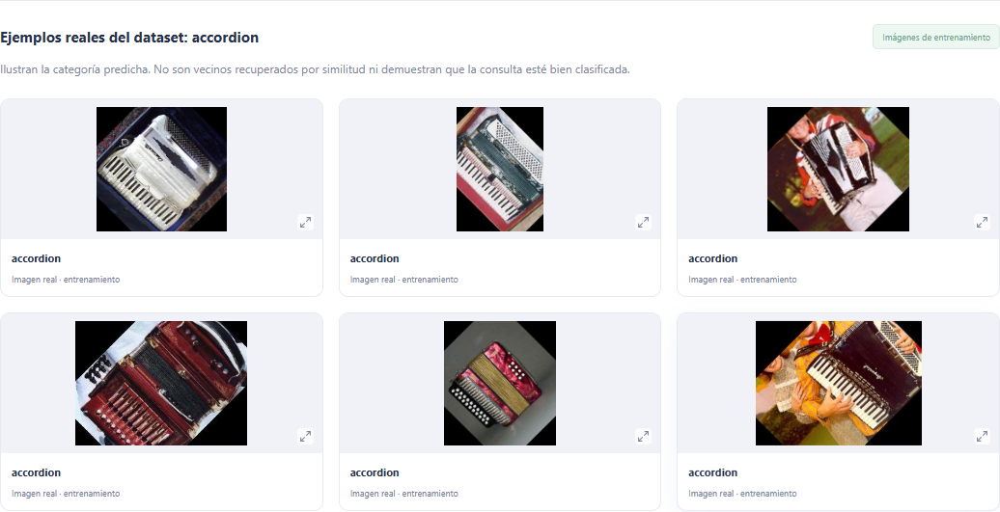

# MetricLab Visual

Aplicación académica local para **clasificar fotografías en 101 categorías** mediante Decision Tree (Gini/entropía), Random Forest, XGBoost y LightGBM. React + TypeScript, FastAPI y laboratorio complementario C++ con búsqueda secuencial, VP-Tree y LAESA.

Dos descriptores: **HSV + Sobel (144D)** y **ResNet-18 congelada (512D)**. Cada uno tiene sus propios modelos. La interfaz muestra probabilidades, tiempos, árboles/importancias, matrices y seis fotografías reales de entrenamiento de la categoría predicha. Los ejemplos **no son vecinos recuperados por similitud**.



[Repositorio](https://github.com/GUIDO-DBP/metriclab-visual) · [Manuales Markdown/PDF](documentacion_entrega/README.md) · [Informe académico PDF](documentacion_entrega/INFORME_GENERAL_METRICLAB_VISUAL.pdf)

## Instalación rápida Windows

Instala Python **3.14 x64**, Node.js **22.12+** y Git. CPU es predeterminada; GPU NVIDIA, opcional.

```powershell
git clone https://github.com/GUIDO-DBP/metriclab-visual.git
cd metriclab-visual
.\scripts\setup.ps1
.\scripts\download_resources.ps1 -Repository GUIDO-DBP/metriclab-visual -Weights
.\.venv\Scripts\python.exe -m scripts.dataset_resources --download
.\scripts\verify_installation.ps1 -Smoke
.\scripts\start.ps1
```

Abre **http://127.0.0.1:8000**. Ctrl+C detiene el servidor. La primera consulta ResNet puede tardar varios segundos. **Instalar y clasificar no reentrena modelos.**

La descarga requiere la Release `resources-v1` accesible: [estado real](docs/PUBLICACION_GITHUB.md). También se admite un ZIP del autor verificado contra el catálogo:

```powershell
.\scripts\download_resources.ps1 -Archive runtime/downloads/metriclab-models-2026-11-19-v2.zip -Weights
```

Si PowerShell bloquea scripts, revisa su contenido y usa `Set-ExecutionPolicy -Scope Process -ExecutionPolicy Bypass` solo en esa sesión. [Instalación completa](documentacion_entrega/09_INSTALACION_EJECUCION.md).

## Recursos

| Recurso | Obtención y necesidad |
| --- | --- |
| Código, manuales, figuras y hashes | Git clone o ZIP del repositorio. |
| Paquete `models` | Release o ZIP local: modelos HSV/ResNet, manifiesto, vectores HSV, registro y métricas. Obligatorio. |
| Caltech-101 | Fuente oficial mediante instalador; fotos para galerías y laboratorio. No se incluye completo en Git. |
| Pesos ResNet | PyTorch con `-Weights`; SHA256 verificado. No duplicados en Git/Releases. |
| Paquete `research` | Release con `-Kind research`; embeddings, históricos y evidencias. Opcional para usar la web. |
| DLL del laboratorio | Compilar con `scripts/build-engine.ps1`. Opcional para clasificación. |

`resources/manifest.json` guarda tamaños y SHA256. Los instaladores conservan archivos idénticos y rechazan diferencias. La separación se restaura desde manifiestos y se comprueba con hashes de imágenes. Los modelos joblib requieren procedencia confiable: no cargues bundles desconocidos.

## Dataset y resultados

Caltech-101: **8.677 imágenes, 101 categorías, 6.941 entrenamiento / 1.736 prueba**. Se excluye `BACKGROUND_Google`. [Distribución completa](resources/dataset_distribution.csv).

| Modelo | HSV accuracy / F1 macro | ResNet accuracy / F1 macro |
| --- | ---: | ---: |
| DT Gini | 32,26 % / 0,1541 | 57,09 % / 0,4237 |
| DT entropía | 30,59 % / 0,1376 | 52,88 % / 0,3553 |
| Random Forest | 46,49 % / 0,2585 | 86,12 % / 0,7903 |
| XGBoost | 48,79 % / 0,2914 | 87,15 % / 0,8184 |
| LightGBM | 46,20 % / 0,2450 | 87,33 % / 0,8160 |

**Prueba histórica reutilizada: no es evaluación independiente nueva.** Las filas son ejecuciones conservadas, no un benchmark simultáneo. La réplica pareada HSV/XGB de dos hilos obtuvo 48,33 % y se documenta separadamente del 48,79 % activo.

LightGBM ResNet original obtuvo 19,76 % y F1 0,1139. Una búsqueda exclusivamente dentro de entrenamiento estabilizó el ajuste: confirmación interna reservada de 87,62 % y F1 0,8224. [Diagnóstico](experiments/lightgbm_resnet/RESULTADOS.md). La tabla utiliza el modelo regularizado. Las probabilidades no están calibradas y no existe rechazo de desconocidos.

[Métricas, fórmulas y tiempos](documentacion_entrega/06_ESTADISTICAS_RESULTADOS.md) · [Resumen JSON](resources/experiment_summary.json) · [Evolución y límites](documentacion_entrega/10_EXPERIMENTOS_CONCLUSIONES.md)

## CPU, GPU y laboratorio

Para forzar CPU:

```powershell
$env:METRICLAB_RESNET_DEVICE='cpu'
.\scripts\start.ps1
```

Con GPU/controlador compatibles, `setup.ps1 -TorchBackend cu130 -Refresh` instala la variante CUDA fijada. `auto` comprueba una operación y permite fallback CPU. CUDA se utiliza para la CNN, no automáticamente para todos los clasificadores. Para desactivar ResNet, configura `$env:METRICLAB_ENABLE_RESNET='0'` y reinicia. `.env.example` no se carga automáticamente.

El laboratorio requiere g++ UCRT64 de MSYS2. `scripts/build-engine.ps1` compila DLL y oráculo. No se envía ResNet512 al motor HSV144. [Arquitectura](documentacion_entrega/07_ARQUITECTURA_CODIGO.md).

## Pruebas y problemas frecuentes

```powershell
.\scripts\verify_installation.ps1 -Smoke
# Pruebas completas con research, imágenes y motor:
.\.venv\Scripts\python.exe -m unittest discover -s tests -v
# Con servidor local y Edge:
cd frontend
npm.cmd run test:e2e
```

Si falta un modelo, instala el paquete; no entrenes automáticamente. Para fotos ausentes, usa `dataset_resources --verify`. Para puerto ocupado, `start.ps1 -Port 8002`. Para frontend ausente, ejecuta `npm.cmd ci` y `npm.cmd run build` en frontend. Para GPU incompatible, utiliza CPU. No desactives comprobaciones para aceptar hashes distintos.

[Prueba limpia](docs/PRUEBA_INSTALACION_LIMPIA.md) · [Auditoría GitHub](docs/AUDITORIA_GITHUB.md) · [Revisión PDF](docs/VERIFICACION_PDF.md)

## Organización y créditos

`frontend/`: interfaz · `backend/`: API · `metriclab/`: C++ · `scripts/`: instalación/inicio · `experiments/`: investigación · `resources/`: catálogos · `documentacion_entrega/`: manuales e informe.

Entornos, `runtime/`, dataset, node_modules, cachés y compilaciones se excluyen de Git sin borrarlos del workspace. Los recursos se distribuyen por separado; no se depende de rutas del autor. `MetricLab_reporte_demo.html` y `Plan_Proyecto_MetricLab_Visual_APA7.docx` son antecedentes, no el informe actual.

Caltech-101: Li, Andreeto, Ranzato y Perona, CaltechDATA, [DOI 10.22002/D1.20086](https://doi.org/10.22002/D1.20086), CC BY 4.0 verificada. Fotografías en figuras/capturas redimensionadas. Los pesos se obtienen de PyTorch y conservan sus condiciones. [Licencias y atribuciones](docs/LICENCIAS_Y_RECURSOS.md). No se ha otorgado una licencia abierta nueva al código propio ni inventado nombres o institución.