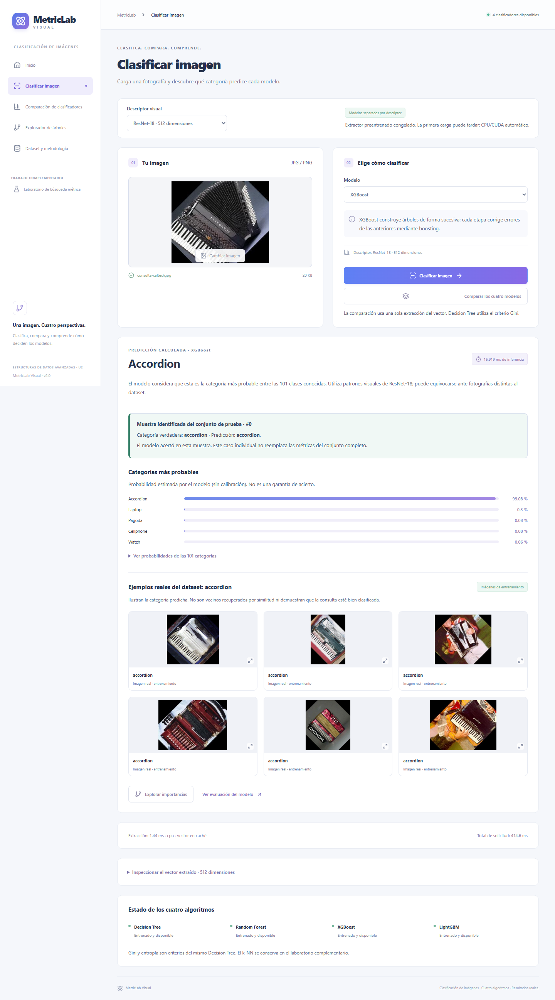
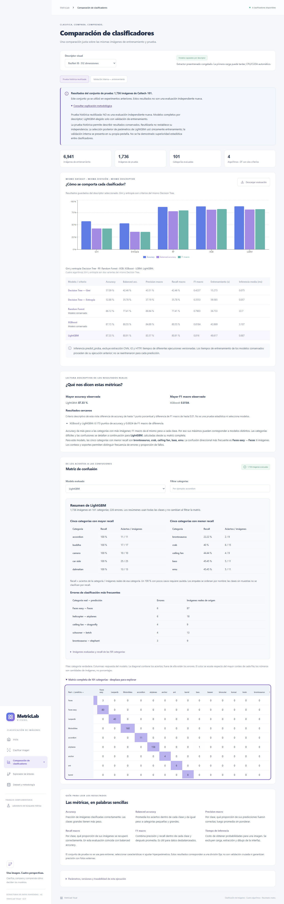

# MetricLab Visual

Aplicación académica para clasificar fotografías de **Caltech-101** mediante **Decision Tree, Random Forest, XGBoost y LightGBM**. Su objetivo es comparar estos cuatro algoritmos con dos representaciones de las mismas imágenes, conservando la separación de entrenamiento y prueba.

**Universidad Nacional del Altiplano** · Escuela Profesional de Ingeniería de Sistemas

Curso: Estructuras de Datos Avanzadas, segunda unidad.

Integrantes: **Guido Suaña Hancco** y **Chambilla Chipana Hernan**.

## Clasificación y resultados

El selector ofrece **HSV + Sobel (144 dimensiones)** y **ResNet-18 preentrenada y congelada (512 dimensiones)**. Cada descriptor utiliza exclusivamente sus propios modelos; Decision Tree permite Gini y entropía. La CNN extrae características con pesos y preprocesamiento oficiales de torchvision; no se entrena desde cero.

La aplicación permite cargar fotografías, comparar modelos, consultar matrices de confusión y explorar árboles reales. Después de predecir muestra seis fotografías de entrenamiento de esa categoría: son ejemplos, no vecinos recuperados por similitud.





Caltech-101: **8.677 fotografías, 101 categorías, 6.941 de entrenamiento y 1.736 de prueba**; se excluye `BACKGROUND_Google`. [Distribución por categoría](resources/dataset_distribution.csv) · [Dataset oficial y DOI](https://doi.org/10.22002/D1.20086).

| Clasificador | HSV + Sobel: accuracy / F1 macro | ResNet-18: accuracy / F1 macro |
| --- | ---: | ---: |
| Decision Tree, Gini | 32,26 % / 0,1541 | 57,09 % / 0,4237 |
| Decision Tree, entropía | 30,59 % / 0,1376 | 52,88 % / 0,3553 |
| Random Forest | 46,49 % / 0,2585 | 86,12 % / 0,7903 |
| XGBoost | 48,79 % / 0,2914 | 87,15 % / 0,8184 |
| LightGBM | 46,20 % / 0,2450 | 87,33 % / 0,8160 |

**Prueba histórica reutilizada:** las 1.736 imágenes ya se utilizaron en experimentos anteriores; estas cifras **no constituyen una nueva evaluación independiente**. Son ejecuciones conservadas, no un benchmark simultáneo. Los resultados cercanos no demuestran superioridad estadística.

LightGBM ResNet corresponde al experimento regularizado; su versión inicial (19,76 % de accuracy) sigue conservada. El ajuste utilizó únicamente entrenamiento y validación interna. [Metodología, métricas y límites](docs/METODOLOGIA_RESULTADOS.md) · [Resultados verificables](resources/experiment_summary.json).

## Instalar y ejecutar en Windows

Requisitos: **Python 3.14 x64**, **Node.js 22.12 o posterior** y Git. CPU es la opción predeterminada; no se necesita GPU para usar la aplicación.

```powershell
git clone https://github.com/GUIDO-DBP/metriclab-visual.git
cd metriclab-visual
.\scripts\setup.ps1
.\scripts\download_resources.ps1 -Repository GUIDO-DBP/metriclab-visual -Weights
.\.venv\Scripts\python.exe -m scripts.dataset_resources --download
.\scripts\verify_installation.ps1 -Smoke
.\scripts\start.ps1
```

Abrir **http://127.0.0.1:8000**. Ctrl+C detiene el servidor. La primera extracción ResNet tarda más porque carga el worker y los pesos. **Instalar y clasificar no reentrena los modelos.**

[Instalación completa, CPU/CUDA y solución de problemas](docs/INSTALACION_WINDOWS.md) · [Dependencias y versiones](requirements/README.md).

## Código y recursos

| Carpeta | Contenido |
| --- | --- |
| [backend](backend/) | FastAPI, extracción, registro de descriptores y clasificación. |
| [frontend](frontend/) | React/TypeScript: clasificación, comparación y exploración. |
| [experiments](experiments/) | Código y resultados de ResNet, validación interna y diagnóstico de LightGBM. |
| [resources](resources/) | Manifiestos, SHA256, etiquetas/distribución, procedencia y resumen de resultados. |
| [scripts](scripts/) | Instalación, descarga, inicio, verificación y reproducción opcional. |
| [tests](tests/) | Pruebas de API, descriptores, preservación y distribución. |
| [metriclab](metriclab/) | Laboratorio complementario C++: Secuencial, VP-Tree y LAESA; incluye el extractor HSV reutilizado. |
| [docs](docs/) | Instalación, arquitectura, metodología, evidencias y auditoría. |
| [requirements](requirements/) | Dependencias fijadas y herramientas opcionales. |

Los modelos se descargan desde [GitHub Releases: resources-v1](https://github.com/GUIDO-DBP/metriclab-visual/releases/tag/resources-v1). El paquete `models` es obligatorio; `research` añade embeddings e históricos para auditoría y pruebas completas. Los pesos ResNet se obtienen de PyTorch; las fotografías se descargan de CaltechDATA. [Catálogo con tamaños y hashes](resources/manifest.json). Entornos, dataset, compilaciones y archivos temporales no van a Git.

Los diez manuales de estudio, sus PDF y el informe preliminar están disponibles en la [rama de archivo](https://github.com/GUIDO-DBP/metriclab-visual/tree/archive/materiales-estudio-2026-11-20/documentacion_entrega). Se conservan como antecedentes; **el informe académico definitivo se incorporará posteriormente**. [Qué se archivó y cómo recuperarlo](docs/ARCHIVO_HISTORICO.md).

## Verificación y límites

```powershell
.\scripts\verify_installation.ps1 -Smoke
# Pruebas completas: instalar research y compilar antes el motor complementario.
.\scripts\build-engine.ps1
.\.venv\Scripts\python.exe -m unittest discover -s tests -v
cd frontend
npm.cmd run test:e2e
```

El laboratorio requiere g++ UCRT64 de MSYS2 y se mantiene separado de la clasificación. Las probabilidades no están calibradas; no hay rechazo automático de categorías desconocidas. No se conoce la categoría verdadera de imágenes externas. La instalación se ha verificado en directorios aislados del mismo equipo, sin demostrar compatibilidad con toda computadora o GPU.

[Arquitectura](docs/ARQUITECTURA.md) · [Mejoras de interpretación](docs/MEJORAS_INTERFAZ_RESULTADOS.md) · [Auditoría de limpieza y pruebas](docs/AUDITORIA_LIMPIEZA_FINAL.md).

## Referencias y atribuciones

Caltech-101: Li, Andreeto, Ranzato y Perona (2022), CaltechDATA, [DOI 10.22002/D1.20086](https://doi.org/10.22002/D1.20086), CC BY 4.0 según sus metadatos oficiales. Las capturas contienen fotografías de ese dataset. ResNet-18: [modelo y pesos oficiales de torchvision](https://docs.pytorch.org/vision/stable/models/generated/torchvision.models.resnet18.html). [Licencias y procedencia de datos, pesos y bibliotecas](docs/LICENCIAS_Y_RECURSOS.md).
