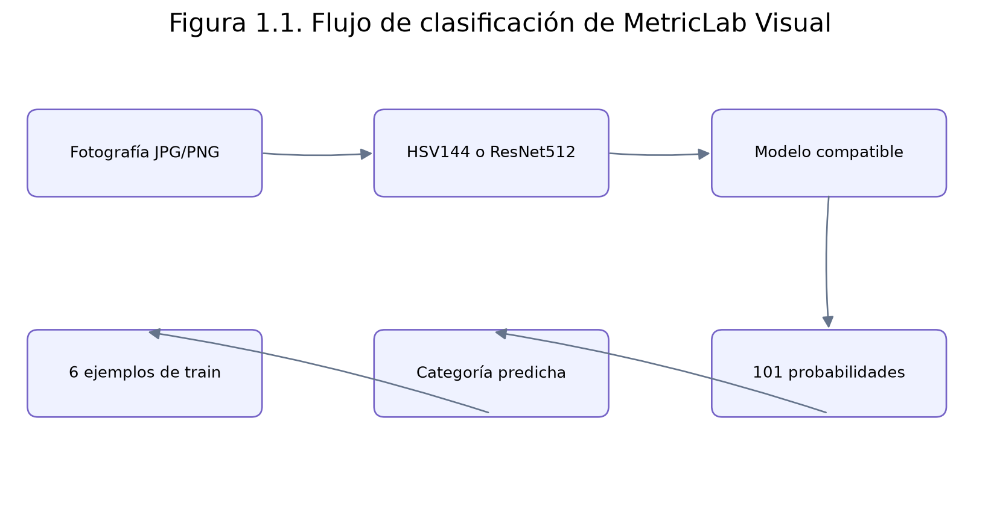

# 01. Introducción general a MetricLab Visual

**Guía de estudio y entrega académica · 19 de noviembre de 2026**  
Autores, institución y docente: completar en la portada del informe general. Este manual describe la implementación existente; las cifras proceden de sus artefactos conservados.

[TOC]

## 1.1. Qué problema resuelve

Una computadora recibe una fotografía como una matriz de números. El nombre del archivo no explica qué aparece en ella. MetricLab Visual estudia cómo transformar esa matriz en una representación útil para predecir una categoría: acordeón, avión, hormiga y otras 98 clases de objetos de Caltech-101. La finalidad es académica: observar el proceso, comparar alternativas y explicar límites, además de obtener una etiqueta.

La aplicación permite cargar una imagen JPG o PNG, seleccionar una representación visual y elegir un clasificador. Presenta la categoría más probable, probabilidades estimadas, tiempos y ejemplos reales del entrenamiento. También permite comparar los cuatro algoritmos sobre el mismo vector. Si discrepan, muestra el desacuerdo; no conoce la respuesta correcta de una fotografía arbitraria del usuario.

El sistema reconoce únicamente sus 101 categorías. Ante una fotografía de un objeto ajeno a ellas seguirá asignando una de esas clases: no se implementó un detector de categoría desconocida. Por tanto, que una probabilidad sea alta no demuestra que el objeto pertenezca al dataset ni que la predicción sea correcta.

## 1.2. Objetivos del proyecto

El objetivo general es construir y estudiar un sistema local de clasificación y búsqueda de imágenes mediante representaciones numéricas y estructuras basadas en árboles. Los objetivos específicos son conservar una división verificable del dataset; implementar una extracción coherente durante entrenamiento e inferencia; comparar Decision Tree, Random Forest, XGBoost y LightGBM; visualizar modelos y resultados reales; y mantener un laboratorio complementario de búsqueda métrica en C++.

En esta etapa de distribución el objetivo práctico es que otro estudiante pueda instalar la aplicación y utilizar los modelos ya entrenados. **Instalar no equivale a entrenar**. Los scripts de recursos restauran archivos verificados y los scripts de inicio solo los cargan. La repetición de experimentos es una actividad opcional y separada.

## 1.3. Dos descriptores, cuatro algoritmos

| Elemento | Papel en MetricLab |
| --- | --- |
| HSV + Sobel | Descriptor original de 144 componentes: color y orientaciones de bordes. |
| ResNet-18 | CNN preentrenada congelada que produce 512 componentes. No se entrenó desde cero. |
| Decision Tree | Un árbol que divide el espacio de características. Gini y entropía son dos criterios del mismo algoritmo. |
| Random Forest | Promedia probabilidades de muchos árboles aprendidos con aleatoriedad. |
| XGBoost | Suma árboles sucesivos para reducir una pérdida regularizada. |
| LightGBM | Implementación de boosting con histogramas y crecimiento por hojas. |

No existe un clasificador universal que acepte cualquier descriptor. Un modelo entrenado con 144 entradas no debe recibir 512, aunque la fotografía y las clases sean las mismas. La aplicación selecciona por la pareja **descriptor + modelo** y valida dimensiones, clases y procedencia. El descriptor HSV sigue como opción inicial; ResNet está disponible cuando sus recursos y su entorno son válidos.

## 1.4. Flujo de una fotografía

Primero se valida el archivo y se decodifica la fotografía. Después se obtiene un vector HSV144 o ResNet512. El modelo compatible calcula probabilidades para las 101 categorías y se elige el máximo. La interfaz devuelve seis fotografías **de entrenamiento de esa etiqueta**, consultando el manifiesto por categoría. Estas fotos no son resultados de una búsqueda por distancia y no prueban el acierto de la consulta.

En la comparación de cuatro clasificadores, la extracción se realiza una sola vez. Cambia el clasificador que procesa el vector, no la representación entre filas. Al cambiar de descriptor se invalidan los resultados anteriores. Esto evita mostrar una predicción obtenida con una representación distinta de la seleccionada.

## 1.5. Relación con Estructuras de Datos Avanzadas

El proyecto reúne dos usos diferentes de árboles y organización de datos. En clasificación, un árbol aprende umbrales de características a partir de etiquetas: sus hojas guardan distribuciones de clases. En búsqueda métrica, VP-Tree organiza objetos mediante distancias y pivotes; LAESA emplea distancias a pivotes como cotas para descartar candidatos. Ninguno de estos dos índices aprende reglas supervisadas para predecir una clase.

El laboratorio complementario conserva búsqueda secuencial, VP-Tree y LAESA sobre HSV144. Sirve para estudiar desigualdad triangular, poda, costo de distancias y verificación con un oráculo secuencial. La parte de clasificación permite estudiar particiones del espacio, conjuntos de árboles, persistencia y complejidad práctica de inferencia. El código C++ sigue disponible aunque el foco actual de la página sea clasificar.

## 1.6. Funciones y límites

La página contiene Inicio, Clasificar imagen, Comparación de clasificadores, Explorador de árboles y Dataset y metodología. El laboratorio métrico se presenta explícitamente como trabajo complementario. Los árboles individuales y los primeros diez árboles del bosque pueden explorarse mediante nodos y rutas. Para boosting se muestran importancias y explicaciones de sus etapas; no se presenta un único árbol como si fuera todo el conjunto.

Las métricas provienen de una división fija: 6.941 imágenes de entrenamiento y 1.736 de prueba histórica. Esa prueba ya fue consultada durante la evolución del proyecto. Sus resultados son descriptivos y **no constituyen una nueva evaluación independiente**. Existen validaciones internas de ResNet y un ajuste de LightGBM efectuado solo dentro de entrenamiento; sus alcances se detallan en los capítulos 05, 06 y 10.

## 1.7. Ruta de lectura

El capítulo 02 explica de dónde salen las imágenes y etiquetas. El 03 construye los vectores desde píxeles. El 04 desarrolla los clasificadores con cálculos. El 05 describe el protocolo de entrenamiento. El 06 enseña a leer las métricas reales. El 07 recorre archivos y solicitudes. El 08 enseña la interfaz. El 09 guía una instalación nueva. El 10 reconstruye la evolución y propone mejoras justificadas. El informe general reúne el argumento académico con referencias APA 7.

**Actividad:** dibuja dos recorridos de una misma fotografía: clasificación supervisada y recuperación por similitud. Indica en cuál se usan etiquetas para aprender y en cuál se calculan distancias durante la búsqueda. Si ambos recorridos devuelven fotos de aviones, explica por qué eso no significa que hayan realizado la misma operación.

## Referencias y evidencia

Código primario del proyecto: `backend/main.py`, `backend/descriptors.py`, `metriclab/src/` y `frontend/src/App.tsx`. Datos numéricos verificables: `resources/experiment_summary.json` y `resources/dataset_distribution.csv`. Referencias externas completas en [BIBLIOGRAFIA.md](BIBLIOGRAFIA.md).
