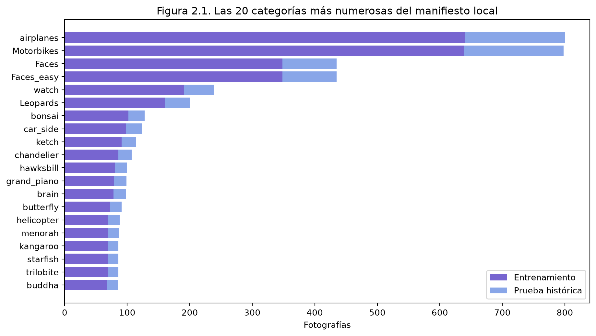
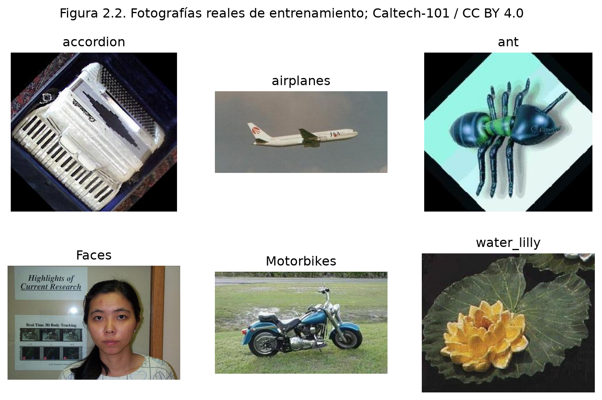

# 02. Dataset Caltech-101 y separación conservada

[TOC]

## 2.1. Origen y condiciones de uso

Caltech-101 fue recopilado en 2003 para investigar reconocimiento de categorías con pocos ejemplos. El registro oficial describe aproximadamente 40–800 imágenes por categoría y fotografías de alrededor de 300 × 200 píxeles. Los creadores del registro son Fei-Fei Li, Marco Andreeto, Marc'Aurelio Ranzato y Pietro Perona (Li et al., 2022). El nombre de autor «Andreeto» se conserva como figura en los metadatos del DOI, aunque existen variantes ortográficas en otras fuentes.

La fuente verificable es [CaltechDATA, DOI 10.22002/D1.20086](https://doi.org/10.22002/D1.20086). Los metadatos de DataCite declaran **Creative Commons Attribution 4.0 International**. La atribución y el enlace de licencia se mantienen en `docs/LICENCIAS_Y_RECURSOS.md`. No se incluye una copia completa en Git: el instalador obtiene el ZIP de la fuente oficial y verifica su checksum publicado.

Las fotografías de ejemplo y las miniaturas visibles en las capturas de este manual proceden de Caltech-101. Se han redimensionado o integrado en composiciones para explicar la aplicación; no fueron generadas por IA ni obtenidas de buscadores. La licencia del dataset no equivale a una garantía sobre todos los posibles derechos de imagen o marcas representadas.

## 2.2. Estructura y conteo real

```text
dataset/
  101_ObjectCategories/
    accordion/
      image_0001.jpg
      ...
    airplanes/
    ant/
    ...
    BACKGROUND_Google/
```

El árbol local original contiene **9.145 archivos**, de los cuales **9.144 terminan en .jpg**. El conteo no debe confundirse con «9.145 JPEG». Se encuentran 468 archivos en `BACKGROUND_Google`; al excluir esa carpeta quedan **8.677 fotografías de 101 categorías** utilizadas por el proyecto. Estos conteos corresponden al árbol realmente inspeccionado y no a una cifra genérica copiada de otra distribución del dataset.

`BACKGROUND_Google` reúne fondos heterogéneos, no una clase de objeto equivalente a las otras 101. El extractor la excluye mediante `SKIP = {"BACKGROUND_Google"}` en `metriclab/demo/extract_features.py`. No se eliminan las imágenes originales del disco; simplemente no se incorporan al manifiesto procesado.

## 2.3. Qué significa una etiqueta

Una fila del manifiesto guarda un ID local, una categoría y una ruta relativa. Por ejemplo, la primera fila de entrenamiento es:

```json
{"id": 0, "category": "accordion",
 "path": "dataset/101_ObjectCategories/accordion/image_0011.jpg"}
```

El ID 0 de entrenamiento y el ID 0 de prueba son distintos: el split forma parte de su identidad. Las etiquetas numéricas de ResNet se construyen usando el orden de `classes.json`, con códigos 0–100. El manifiesto original sigue su propio orden de categorías. Por eso no se asume que «fila 0» o «categoría 0» sean el mismo concepto. La aplicación traduce las predicciones numéricas mediante la lista de clases asociada al modelo.

## 2.4. División de entrenamiento y prueba

Se conserva exactamente la división original: **6.941 entrenamiento y 1.736 prueba histórica**. No se ejecuta una nueva separación para instalar ni para cambiar de descriptor. El script original ordena carpetas y archivos, baraja mediante un generador compartido con semilla 7 y reserva, en cada categoría, aproximadamente el 20 % para consulta. Usa `round(n * .2)` y asegura que quede al menos una imagen por partición.

Esta es una división estratificada por categoría implementada en el script; no corresponde a llamar posteriormente a `train_test_split` con una semilla que solo parezca equivalente. Por ejemplo, para una clase de 55 imágenes se reservan 11 y se entrenan 44; para una de 800 se reservan 160 y se entrenan 640. La suma de redondeos por clase determina los totales finales.

El fingerprint guardado es:

```text
1dad6c2f85e8d806ba351218a934b5955e8bc7afc25b063f8f95751efaa2455f
```

Se calcula a partir de vectores HSV y filas del manifiesto. Para comprobar además el contenido de las fotografías, `resources/image_manifest.json` conserva SHA-256 de las 8.677 imágenes, su categoría, split e ID. Una carpeta con los mismos nombres pero fotos diferentes no pasa esta comprobación.

## 2.5. Distribución y desbalance



En entrenamiento hay entre **25 y 640** imágenes por clase: una relación de **25,6 a 1**. Un modelo podría acertar muchas imágenes de clases grandes y fallar en las pequeñas. Accuracy resume aciertos por imagen; balanced accuracy da el mismo peso al recall de cada categoría. F1 macro permite observar simultáneamente omisiones y predicciones incorrectas por clase.

La distribución completa de las 101 clases está en [dataset_distribution.csv](../resources/dataset_distribution.csv), con columnas `category`, `train` y `historical_test`. La página «Dataset y metodología» presenta esos mismos conteos en una tabla. No se balanceó el conjunto duplicando imágenes ni se ocultaron las categorías difíciles.



## 2.6. Preparar las imágenes sin cambiar la división

La instalación utiliza dos fuentes distintas. El paquete de modelos contiene manifiesto, vectores HSV y modelos ya ajustados. El ZIP oficial contiene las fotografías. `scripts/dataset_resources.py` extrae solo imágenes de categorías a una carpeta temporal, verifica todas las imágenes esperadas y las copia de forma aditiva al destino. Si encuentra un archivo existente con hash distinto, se detiene; no lo sobrescribe.

```powershell
.\.venv\Scripts\python.exe -m scripts.dataset_resources --download
.\.venv\Scripts\python.exe -m scripts.dataset_resources --verify
```

Si ya se dispone del ZIP oficial, se puede usar `--archive RUTA_DEL_ZIP`. Si se dispone de una carpeta descomprimida, `--source RUTA_DE_101_ObjectCategories`. La carpeta de origen puede estar fuera del proyecto; los archivos verificados se copian al destino portable. Esta operación no entrena y no decide qué imágenes van a cada split.

## 2.7. Limitaciones del dataset

Caltech-101 no representa toda la variación de fotografías actuales. Muchos objetos aparecen centrados y con fondos característicos. Un modelo puede aprovechar esas regularidades y fallar con escenas complejas, objetos parcialmente visibles o varias categorías simultáneas. Las 101 etiquetas tampoco forman un sistema completo de categorías del mundo.

En los artefactos de extracción se verificó que no había contenidos de imagen idénticos entre los dos splits conservados. Esto no demuestra ausencia de escenas relacionadas ni de solapamiento con ImageNet, corpus de preentrenamiento de ResNet. Ese posible solapamiento no se auditó.

La prueba ya fue observada durante la elección del descriptor y las comparaciones anteriores. Mantenerla fija permite trazabilidad, pero no recupera su condición de evaluación totalmente nueva. La confirmación futura debería utilizar imágenes externas o un protocolo prospectivo definido antes de observar sus resultados.

**Actividad:** usa el CSV para calcular el porcentaje de entrenamiento perteneciente a la clase más grande. Explica por qué esa clase tiene mayor influencia en accuracy que una clase con 25 registros, y por qué balanced accuracy reduce esa diferencia sin resolver por sí sola la escasez de ejemplos.

## Referencias

Li, F.-F., Andreeto, M., Ranzato, M., & Perona, P. (2022). *Caltech 101* (Version 1.0) [Data set]. CaltechDATA. https://doi.org/10.22002/D1.20086

Registro de licencia verificado: https://api.datacite.org/dois/10.22002/D1.20086. Código primario: `scripts/prepare.py`, `scripts/dataset_resources.py`, `experiments/resnet18/common.py`.
