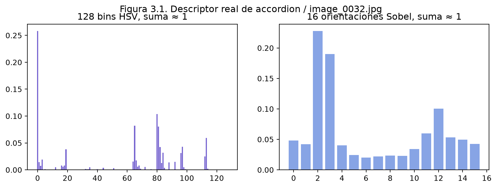
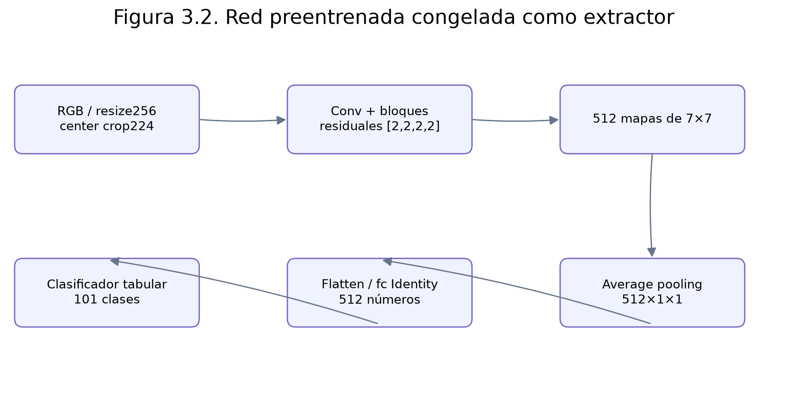

# 03. De píxeles a características visuales

[TOC]

## 3.1. Píxeles y canales RGB

Una imagen digital es una cuadrícula de píxeles. En una fotografía RGB típica cada píxel contiene tres intensidades: rojo, verde y azul, normalmente entre 0 y 255. Un píxel (255, 0, 0) es rojo; (0, 0, 0), negro; (255, 255, 255), blanco. Una imagen de 300 × 200 contiene 60.000 píxeles y 180.000 valores de canal. Esa cantidad cambia con la resolución, por lo que no es una entrada uniforme para nuestros clasificadores tabulares.

El descriptor resume la imagen en una longitud fija. Dos fotos con tamaños distintos producirán ambas 144 valores HSV/Sobel o 512 valores ResNet. La reducción descarta información y conserva determinados patrones: no existe un resumen que preserve todos los detalles posibles.

OpenCV decodifica en BGR y convierte explícitamente a HSV. La rama ResNet usa PIL y convierte a RGB. Intercambiar el orden de canales cambia los números y rompe la correspondencia con el entrenamiento, aunque la imagen se vea parecida en pantalla.

## 3.2. HSV y el histograma de 128 componentes

HSV separa tono H, saturación S y valor V. El tono expresa el tipo de color; la saturación, su distancia respecto de un gris; el valor, su intensidad máxima de canal. Con RGB normalizado, sea M el máximo de los tres canales y m el mínimo: V=M; si M es positivo, S=(M−m)/M. El tono depende del canal máximo y de diferencias entre canales.

Para RGB (200, 100, 50), M=200/255≈0,7843, m=50/255≈0,1961 y S=150/200=0,75. Al ser rojo el máximo, H≈60·(100−50)/150=20 grados. OpenCV en el formato usado representa el tono aproximadamente como 10 en su escala 0–179, S≈191 y V=200. Los redondeos dependen de la conversión de la biblioteca.

Un histograma cuenta cuántos píxeles caen en intervalos o bins. El código real divide H en 8 intervalos, S en 4 y V en 4: **8 × 4 × 4 = 128** celdas. No son 128 colores exactos, sino regiones del espacio HSV. El siguiente fragmento se conserva en `metriclab/demo/extract_features.py`:

```python
hsv = cv2.cvtColor(img_bgr, cv2.COLOR_BGR2HSV)
h = cv2.calcHist([hsv], [0, 1, 2], None,
                 [8, 4, 4], [0, 180, 0, 256, 0, 256]).flatten()
return h / max(h.sum(), 1e-9)
```

Si en una imagen de 128 × 128 hay 2.048 píxeles en un bin, ese componente vale 2.048/16.384=0,125. Dividir por el total evita que una fotografía tenga mayor magnitud solo por contener más píxeles. La desventaja es que el histograma no indica dónde estaban esos colores: intercambiar dos regiones puede dejar casi los mismos conteos.

## 3.3. Sobel y las 16 orientaciones

Un borde es una variación espacial de intensidad. El extractor convierte a gris y aplica filtros Sobel para aproximar derivadas horizontal y vertical. Los núcleos habituales de tamaño 3 son:

```text
Gx: -1  0  1        Gy: -1 -2 -1
    -2  0  2             0  0  0
    -1  0  1             1  2  1
```

Para una ventana con columnas [0, 100, 200] iguales en las tres filas, Gx=800 y Gy=0 en el centro. La magnitud es √(800²+0²)=800. Una ventana con Gx=3 y Gy=4 tendría magnitud 5 y ángulo arctan2(4,3)≈53,13 grados. Estos números ilustran la operación; no se afirma que sean valores de una fotografía específica del dataset.

El código acumula las magnitudes en 16 intervalos de orientación **sin sentido**: [0, π). Así, una transición clara→oscura y su inversa tienen la misma orientación geométrica. Cada intervalo cubre 180/16=11,25 grados. Se normaliza la suma de magnitudes. En una imagen uniforme sin gradientes el vector de bordes puede ser cero, gracias al denominador protegido por 1e−9.

```python
gx = cv2.Sobel(gray, cv2.CV_32F, 1, 0, ksize=3)
gy = cv2.Sobel(gray, cv2.CV_32F, 0, 1, ksize=3)
mag = np.sqrt(gx * gx + gy * gy)
ang = (np.arctan2(gy, gx) + np.pi) % np.pi
h, _ = np.histogram(ang, bins=16, range=(0, np.pi), weights=mag)
```

La fotografía se redimensiona a 128 × 128 mediante `INTER_AREA`. Se concatenan los 128 bins HSV y los 16 de bordes: **144 dimensiones float32**. Cada bloque se normaliza por separado; normalmente la suma del vector completo es aproximadamente 2, no 1. No se añade una normalización global diferente durante inferencia.



## 3.4. Qué aprende una CNN

Una red convolucional aplica filtros compartidos a distintas posiciones de una imagen. Las activaciones de capas sucesivas combinan respuestas locales. A diferencia de fijar de antemano bins de color, sus filtros se aprenden al optimizar una tarea con ejemplos. En MetricLab esos filtros ya estaban entrenados en ImageNet; solo se usan para representar imágenes.

ResNet incorpora conexiones residuales: un bloque calcula una transformación F(x) y suma una conexión de x, con proyección cuando cambian las dimensiones. La formulación es y=F(x)+x cuando las formas coinciden (He et al., 2016). Eso facilita optimizar redes profundas. No significa que el modelo pueda explicar verbalmente cada objeto ni que un componente aislado sea «un ojo» o «una rueda».

ResNet-18 tiene una convolución inicial, grupos de bloques básicos [2,2,2,2] con 64,128,256 y 512 canales, pooling global y una capa final de clasificación en su diseño original. El nombre 18 cuenta capas con parámetros según la arquitectura publicada; no equivale a contar todos los módulos Python.



## 3.5. Preentrenamiento, congelación y modo evaluación

Los pesos `ResNet18_Weights.IMAGENET1K_V1` fueron aprendidos para clasificar 1.000 categorías de ImageNet. El proyecto los carga mediante torchvision, reemplaza `fc` por `Identity`, desactiva gradientes y usa modo evaluación. No se reaprenden convoluciones ni se adaptan estadísticas BatchNorm con Caltech-101.

```python
weights = ResNet18_Weights.IMAGENET1K_V1
network = resnet18(weights=weights, progress=True)
network.fc = torch.nn.Identity()
network.requires_grad_(False)
network.eval()
preprocessing = weights.transforms()
```

La extracción se realiza dentro de `torch.inference_mode()`. Congelar parámetros y poner evaluación son controles distintos: el primero impide actualizarlos por gradiente; el segundo configura capas con comportamiento diferente en entrenamiento y evaluación. El experimento comparó el hash del estado antes y después de extraer para verificar que tampoco cambió BatchNorm.

## 3.6. Preprocesamiento oficial, paso a paso

La imagen se convierte a RGB. Se redimensiona el lado corto a 256 y se toma un recorte central de 224 × 224. Este procedimiento conserva proporciones antes del recorte; no consiste en deformar directamente a 224 × 224. Los canales pasan a valores entre 0 y 1 y se normalizan con medias [0,485; 0,456; 0,406] y desviaciones [0,229; 0,224; 0,225].

Por ejemplo, un canal rojo de valor 128 produce (128/255−0,485)/0,229≈0,074. Un valor normalizado puede ser negativo o superar 1: eso es esperado. Se usa directamente `weights.transforms()` para mantener la misma interpolación y transformación oficial, sin sustituirla por una aproximación manual. Las instrucciones están en la [documentación de ResNet-18](https://docs.pytorch.org/vision/stable/models/generated/torchvision.models.resnet18.html).

## 3.7. Average pooling y los 512 componentes

Con la entrada de 224 × 224, la última representación convolucional contiene 512 mapas de 7 × 7. Average pooling calcula la media espacial de cada mapa. Si un mapa de ejemplo tuviera valores [1,3;5,7], su media sería 4. En la red real cada media resume 49 posiciones:


Se obtienen 512 valores, se aplana la dimensión espacial y `fc=Identity` deja pasar esas activaciones. No se utilizan las 1.000 probabilidades originales de ImageNet como vector. Tampoco se aplica una normalización L2 adicional al embedding del proyecto.

Un componente es la respuesta agregada de un canal aprendido en interacción con los demás. Puede correlacionarse con patrones, pero no tiene una etiqueta semántica garantizada. En el explorador se denomina «componente del embedding N» para evitar atribuirle una explicación que no fue comprobada.

## 3.8. Guardado, reutilización y mejora observada

Las matrices se guardan en `.npy`: entrenamiento (6941,512) y prueba (1736,512), float32, junto a etiquetas, clases y filas con SHA de imagen. Al reutilizarlas se verifica forma, finitud, orden, hash del archivo y correspondencia con el manifiesto. No se vuelve a ejecutar la CNN para entrenar cada clasificador ni cada fold.

Durante una consulta nueva el worker sí calcula un embedding; su resultado se puede guardar en una caché limitada por hash de imagen e ID del descriptor. Los modelos persistidos se cargan en lectura y no se ajustan con la fotografía del usuario.

En las comparaciones reales, RF pasó de 46,49 % a 86,12 % de accuracy. La representación aprendida conserva información visual útil que los histogramas globales pierden. Esta es una interpretación compatible con los resultados, no una demostración de qué canal concreto explica la mejora. El descriptor tampoco benefició inmediatamente a cualquier configuración: LightGBM original falló hasta estabilizar su entrenamiento. Más dimensiones por sí solas no garantizan mejor clasificación.

**Actividad:** explica por qué ordenar aleatoriamente las 512 columnas antes de inferir puede arruinar un modelo, aunque la dimensión siga siendo correcta. Después indica por qué no basta con comprobar `n_features_in_` para aceptar un extractor diferente.

## Referencias y código

He et al. (2016), referencia completa en BIBLIOGRAFIA.md. Código: `metriclab/demo/extract_features.py`, `backend/core.py`, `experiments/resnet18/extract.py`, `backend/resnet_worker.py`. Resultados y checksums: paquete research y `resources/experiment_summary.json`.
