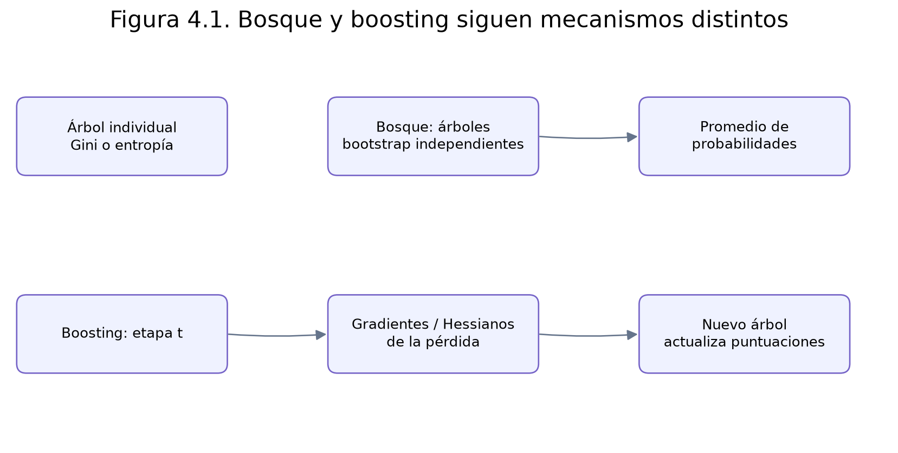

# 04. Clasificadores: árboles, bosques y boosting

[TOC]

## 4.1. El problema supervisado

Cada fotografía de entrenamiento se representa por un vector x y una etiqueta y. Con HSV, x tiene 144 entradas; con ResNet, 512. Las etiquetas se codifican como enteros 0–100, pero esa codificación no establece un orden entre objetos: que avión tenga un código mayor que hormiga no significa que esté «más arriba» en una escala semántica.

Un clasificador aprende una función que transforma x en puntuaciones o probabilidades por clase. La predicción es la clase con mayor valor. El modelo no compara el nombre del archivo ni consulta la etiqueta real de la fotografía del usuario. Los cuatro algoritmos reciben los mismos vectores dentro de cada comparación, pero tienen mecanismos de aprendizaje diferentes.

## 4.2. Decision Tree: preguntas y particiones

Un árbol de decisión formula preguntas del tipo «¿x[j] ≤ umbral?». Cada respuesta lleva a un hijo. La construcción comienza con todas las filas de entrenamiento en la raíz y busca una variable y un umbral que separen mejor las clases. Después repite el proceso en los hijos hasta alcanzar sus restricciones o no encontrar una mejora.

Las hojas guardan distribuciones de clases de sus ejemplos. Si una hoja contiene 8 acordeones y 2 cámaras, su distribución básica es [0,8;0,2] en esas dos categorías. Eso no representa la probabilidad de acierto externo de 80 %: solo resume la distribución aprendida y no está calibrada con fotografías externas.

En un embedding, una pregunta puede ser «componente 237 ≤ 0,58». El componente tiene significado numérico dentro del extractor congelado, pero no se puede traducir automáticamente como «tiene teclado». El explorador muestra el número de muestras, umbral, impureza, clases y condición tomada por la fotografía cargada.

### 4.2.1. Gini y entropía

Gini vale cero cuando todos los registros pertenecen a la misma clase. La entropía también es cero para un nodo puro, con la convención 0·log(0)=0. En una mezcla de dos clases al 50 %, Gini=1−0,5²−0,5²=0,5 y entropía=−2·0,5·log₂(0,5)=1 bit. No se comparan directamente 0,5 y 1 como si compartieran escala: son criterios distintos.

Ejemplo resuelto: un nodo padre contiene 6 imágenes A y 4 B. Sus proporciones son 0,6 y 0,4, por lo que Gini=1−0,36−0,16=0,48. Su entropía es −0,6·log₂(0,6)−0,4·log₂(0,4)≈0,9710 bits.

Un corte candidato produce un hijo izquierdo con 4 A y 0 B y un derecho con 2 A y 4 B. Gini izquierdo=0. Gini derecho=1−(2/6)²−(4/6)²=4/9≈0,4444. La impureza ponderada queda (4/10)·0+(6/10)·0,4444≈0,2667; la reducción es 0,48−0,2667≈**0,2133**.

Con entropía, el hijo derecho tiene H≈0,9183 y la entropía ponderada es 0,6·0,9183≈0,5510. La ganancia es 0,9710−0,5510≈**0,4200 bits**. Ambos criterios pueden favorecer ese corte, pero no tienen por qué ordenar igual todos los cortes de un dataset real.

### 4.2.2. Selección y limitaciones

Se evalúan cortes sobre variables candidatas y se selecciona la reducción de impureza permitida por el estimador. La decisión es local: elegir el mejor corte actual no garantiza el árbol globalmente óptimo. Un árbol profundo puede memorizar irregularidades. Cambios pequeños en datos o empates pueden producir otra estructura.

Los modelos ResNet originales usan `criterion='gini'` o `'entropy'`, `max_depth=None`, `min_samples_split=2`, `min_samples_leaf=1`, `ccp_alpha=0` y `random_state=0`. Se conserva la configuración completa en el resumen de parámetros y protocolos. No se podaron nuevamente para esta entrega. Sus accuracies históricos son 57,09 % y 52,88 %; son inferiores a los conjuntos de árboles.

## 4.3. Random Forest: agregar árboles diferentes

Un bosque busca reducir la variabilidad de un árbol individual. En bootstrap se toman filas con reemplazo: algunas pueden repetirse y otras quedar fuera de un árbol. Además, en cada corte solo se considera una selección de características. Estas dos fuentes de aleatoriedad favorecen que los errores de los árboles no sean idénticos.

En el bosque de MetricLab hay **200 árboles**, con `bootstrap=True`, `max_features='sqrt'`, `random_state=0` y `n_jobs=2` en el modelo ResNet. Para 512 entradas, la raíz cuadrada es aproximadamente 22,6; el estimador selecciona un número entero de características según su implementación. No significa que se reduzca permanentemente el vector a 22 columnas: la selección cambia entre nodos.

La API de sklearn promedia probabilidades de los árboles. Si tres árboles hipotéticos producen para A [0,7;0,4;0,8], el promedio de A es (0,7+0,4+0,8)/3≈0,6333. Si B recibe el resto, A gana. No debe explicarse necesariamente como una votación de etiquetas duras: promediar distribuciones puede dar otro resultado que contar únicamente las clases máximas de cada árbol.

El bosque suele ser más estable que un árbol, pero ocupa más memoria y requiere recorrer muchos árboles por consulta. Las importancias por reducción de impureza muestran cuánto contribuyeron variables a cortes durante el ajuste; no prueban causalidad y pueden favorecer variables con muchas oportunidades de corte. La página permite explorar los primeros diez árboles, no afirma que esos diez sean todo el bosque de 200.

## 4.4. Gradient boosting: corregir una pérdida

Boosting construye un modelo aditivo. En la etapa t se conservan las puntuaciones anteriores y se añade un árbol nuevo, multiplicado por una tasa de aprendizaje. El entrenamiento busca reducir una pérdida respecto de las etiquetas. En clasificación multiclase se trabaja con puntuaciones por clase, transformadas mediante softmax a probabilidades; no es simplemente «entrenar otro árbol con las fotos mal clasificadas».

Un ejemplo simplificado de regresión ayuda a entender la secuencia: si los valores reales son [3,5] y la predicción anterior [2,4], los residuos son [1,1]. Un árbol que aproxime esa corrección, con learning rate 0,1, añadiría [0,1;0,1]. En clasificación logística la corrección se obtiene de gradientes de la pérdida y no de restar directamente códigos de clase.

## 4.5. XGBoost: objetivo y regularización

XGBoost desarrolla un sistema eficiente para ajustar conjuntos de árboles regularizados (Chen & Guestrin, 2016). El objetivo combina pérdida sobre ejemplos y complejidad del árbol. Un esquema habitual de regularización añade un costo por hoja y una penalización cuadrática de sus valores. La aproximación de segundo orden utiliza gradientes g y Hessianos h:

Ejemplo ilustrativo, no una hoja real: si la suma de gradientes es −6 y la suma de Hessianos 2, sin regularización el valor sería 3. Con λ=4 se reduce a 1. La tasa de aprendizaje puede reducir adicionalmente su aporte. La fórmula muestra por qué regularizar limita actualizaciones grandes, aunque una implementación real tiene más restricciones y tratamiento multiclase.

En ResNet se conservan `objective='multi:softprob'`, 101 clases, **80 etapas**, profundidad máxima **4**, learning rate **0,1**, `tree_method='hist'`, semilla **0** y dos hilos. Los demás parámetros efectivos se encuentran en `resources/experiment_summary.json`, sección `parameters_resnet.xgboost`. No se cambió el modelo para esta publicación.

El método histogramas agrupa valores de características para evaluar cortes de forma eficiente. Cambiar número de bins, hilos u otras configuraciones puede alterar empates y resultados; por eso el experimento conservó una auditoría separada de la réplica HSV cuando limitar hilos produjo 48,33 % en vez del 48,79 % histórico. No se sustituyó una cifra por otra silenciosamente.

## 4.6. LightGBM: histogramas y crecimiento por hojas

LightGBM también implementa gradient boosting. En el crecimiento por hojas prioriza la hoja cuya división ofrece mayor mejora permitida, en lugar de expandir obligatoriamente todos los nodos de un nivel. Una profundidad máxima y un límite de hojas controlan aspectos diferentes: una estructura muy asimétrica puede profundizar con pocas hojas. El artículo original introduce además GOSS y EFB (Ke et al., 2017), pero **el proyecto usa `boosting_type='gbdt'`**: no se debe afirmar que activó GOSS por citar ese artículo.

En MetricLab, el LightGBM ResNet original tenía `num_leaves=15`, `max_depth=6`, `min_child_samples=20`, `learning_rate=0.1`, `n_estimators=80`, `max_bin=63`, `min_child_weight=0.001`, `reg_alpha=0` y `reg_lambda=0`. Sus resultados fueron deficientes: accuracy 19,76 %, F1 macro 0,1139 en la prueba histórica.

### 4.6.1. Diagnóstico real

Se comprobaron 512 entradas correctas, 101 clases y alineación de etiquetas. En un fold de desarrollo los márgenes crecieron hasta 37.373 mientras la probabilidad máxima media se aproximaba a 0,99939, aunque había muchos errores. En confirmación interna el original llegó a 81.799,80 de margen máximo y solo predijo 30 clases. La alta «confianza» no indicaba aprendizaje correcto.

Las advertencias de falta de ganancia para nuevas divisiones se registraron y contaron. También aparecen en el modelo mejorado, por lo que no se atribuye el colapso únicamente a ese mensaje. Las curvas mostraron que el modelo inicialmente aprendía y después se desestabilizaba. Revisar solo la última accuracy habría ocultado ese comportamiento.

### 4.6.2. Ajuste y resultado

La búsqueda controlada probó hojas 7/15/31, profundidad 3/6/8/sin límite, mínimos de muestras 10/20/40, tasas 0,03/0,05/0,1, etapas 80/120/160/240 y distintas regularizaciones mediante siete combinaciones prefijadas, no el producto cartesiano completo.

Ganó por F1 macro medio de CV la configuración de **15 hojas, profundidad 6, mínimo 20 muestras, learning rate 0,1, 120 etapas, Hessiano mínimo 1,0, L1=0,1 y L2=5,0**. Se mantuvieron semilla 0, dos hilos, multiclass, 101 clases y determinismo. En confirmación interna reservada obtuvo 87,62 % y F1 macro 0,8224; el modelo final alcanzó 87,33 % y 0,8160 en la prueba histórica reutilizada.

La mejora coincide con actualizaciones estabilizadas y márgenes de aproximadamente 9 en confirmación. No hubo ablación suficiente para aislar una causa única: aumentaron conjuntamente el mínimo Hessiano, las penalizaciones y las etapas. Tampoco se demostró un óptimo global. Los JSON y curvas de la investigación se conservan en el paquete research.

## 4.7. Comparación conceptual

| Aspecto | Decision Tree | Random Forest | XGBoost / LightGBM |
| --- | --- | --- | --- |
| Aprendizaje | Cortes de un árbol | Árboles con aleatoriedad | Árboles sucesivos según una pérdida |
| Combinación | Hoja final | Promedio de probabilidades | Suma de puntuaciones y transformación probabilística |
| Riesgo típico | Varianza / memorización | Costo y correlación entre árboles | Sensibilidad a parámetros y actualizaciones |
| Explicación disponible | Ruta individual | Rutas de árboles e importancias | Importancias y etapas del conjunto |

VP-Tree y LAESA pertenecen a otro problema. No usan Gini o entropía para aprender clases; utilizan distancias y cotas para encontrar vecinos. No se deben sumar sus tiempos de búsqueda a la tabla de inferencia de clasificadores como si fueran el mismo experimento.

**Actividad:** calcula la ganancia Gini si el corte del ejemplo separa [3 A,2 B] en cada hijo. Obtendrás la misma proporción del padre y mejora cero. Explica por qué dividir un nodo no garantiza aportar información.

## Referencias

Breiman (2001), Chen y Guestrin (2016), Ke et al. (2017), y documentación de sklearn/LightGBM; datos bibliográficos y enlaces en BIBLIOGRAFIA.md. Parámetros efectivos: `resources/experiment_summary.json`; implementación: `backend/modeling.py`, `scripts/train_classifiers.py` y los módulos `experiments/`.
