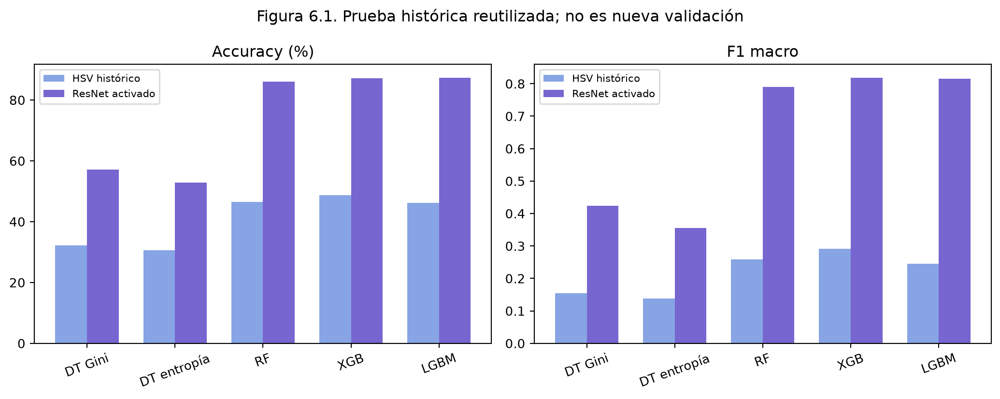
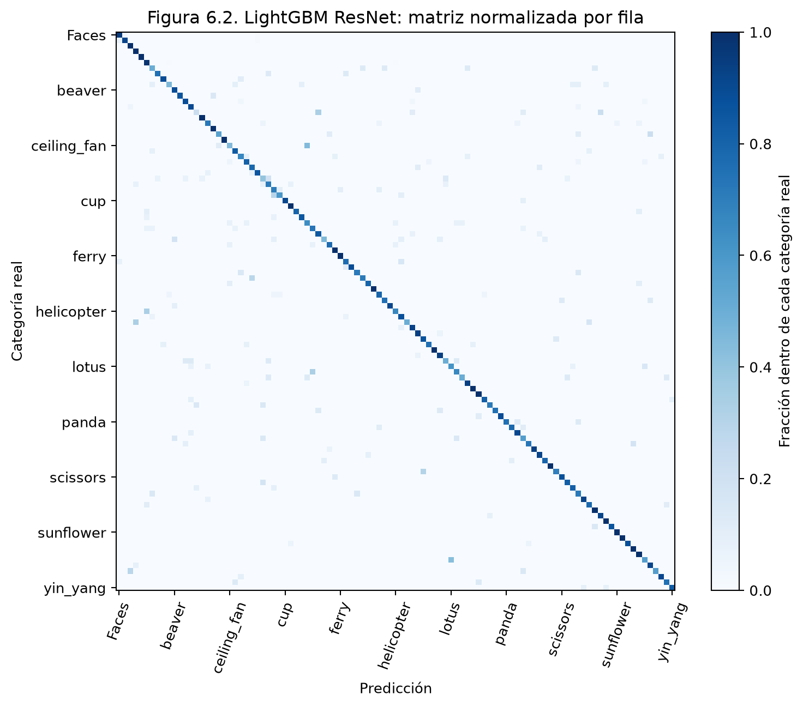

# 06. Cómo calcular e interpretar los resultados

[TOC]

## 6.1. Matriz de confusión

Una matriz C tiene categorías reales en filas y predichas en columnas. C[i,j] cuenta imágenes de clase i predichas como j. La diagonal contiene aciertos. En MetricLab existen 101 × 101=10.201 celdas; no es razonable intentar leer cada una a la vez. La vista filtrada ayuda a inspeccionar categorías, pero las métricas globales siguen calculadas sobre el conjunto completo, no solo sobre lo visible.

Ejemplo didáctico de tres categorías, independiente de los resultados reales:

| Real / predicha | A | B | C | Soporte |
| --- | ---: | ---: | ---: | ---: |
| A | 18 | 2 | 0 | 20 |
| B | 1 | 2 | 1 | 4 |
| C | 0 | 1 | 1 | 2 |
| Total predicho | 19 | 5 | 2 | 26 |

El soporte es el número real de ejemplos de una clase. Para B, TP=2, FP=2+1=3 y FN=1+1=2. Los falsos positivos provienen de la columna B fuera de su diagonal; los falsos negativos, de la fila B fuera de la diagonal.

## 6.2. Accuracy y balanced accuracy

En el ejemplo hay 18+2+1=21 aciertos de 26: **accuracy=80,77 %**. Los recalls son 18/20=0,9; 2/4=0,5; y 1/2=0,5. Balanced accuracy=(0,9+0,5+0,5)/3=**63,33 %**. La diferencia revela que la clase grande A domina el porcentaje de aciertos por imagen.

Balanced accuracy no vuelve más abundantes las clases pequeñas ni corrige sus errores: cambia el peso con que se resumen. En Caltech local es útil porque entrenamiento tiene entre 25 y 640 imágenes por clase.

## 6.3. Precision, recall y F1 macro

Precision pregunta qué fracción de lo predicho como B era realmente B: 2/5=0,4. Recall pregunta qué fracción de las B reales se encontró: 2/4=0,5. F1_B=2·0,4·0,5/(0,4+0,5)=0,4444.

F1_A=36/(36+1+2)=0,9231 y F1_C=2/(2+1+1)=0,5. **F1 macro=(0,9231+0,4444+0,5)/3≈0,6225**. Se calcula F1 de cada clase y luego se promedia. No equivale a aplicar la fórmula a precision macro y recall macro. El proyecto usa `zero_division=0` cuando una métrica de categoría carece de denominador válido.

## 6.4. Media y desviación estándar

Para accuracies [0,80;0,82;0,84], la media es 0,82. La suma de desviaciones cuadradas es 0,0008; dividiendo entre 3−1 y sacando raíz, s=0,02: 2 puntos porcentuales. No se confunde «±2 puntos» con «±2 % de 82».

Los folds comparten filas de ajuste. La DE mide dispersión y no demuestra significación estadística ni es un intervalo de confianza automático. La búsqueda de LightGBM tuvo tres folds de desarrollo; la comparación original, cinco folds de todo entrenamiento. Sus medias no deben presentarse como si compartieran protocolo.

## 6.5. Resultados reales HSV + Sobel

**Alcance:** modelos activos del run `20261118T134358Z-421958bc`, 1.736 imágenes de prueba histórica reutilizada. No es una nueva validación independiente. Los tiempos de ajuste de árboles y bosque se conservaron de entrenamientos anteriores.

| Modelo | Accuracy | Balanced acc. | F1 macro | Ajuste (s) | Inferencia (ms) |
| --- | ---: | ---: | ---: | ---: | ---: |
| DT Gini | 32,26 % | 15,90 % | 0,1541 | 1,024 | 0,054 |
| DT entropía | 30,59 % | 13,77 % | 0,1376 | 2,813 | 0,053 |
| Random Forest | 46,49 % | 24,77 % | 0,2585 | 1,160 | 22,949 |
| XGBoost | 48,79 % | 28,21 % | 0,2914 | 10,692 | 1,382 |
| LightGBM | 46,20 % | 23,69 % | 0,2450 | 5,999 | 0,812 |

El mayor accuracy no significa que todas las clases tengan cerca de 49 % de recall: balanced accuracy de XGBoost es solo 28,21 %. Los histogramas capturan color y orientaciones, pero descartan mucha organización espacial. Una etiqueta frecuente puede aportar más aciertos que una categoría pequeña y variable.

## 6.6. Resultados reales ResNet integrados

**Alcance:** mismo test histórico, modelos completos conservados del experimento padre y comparación, más LightGBM regularizado. No es un ajuste simultáneo de los cinco. Los tiempos de inferencia RF/XGB proceden de la ampliación; el de LightGBM ajustado, de su ejecución posterior.

| Modelo | Accuracy | Balanced acc. | F1 macro | Ajuste (s) | Inferencia (ms) |
| --- | ---: | ---: | ---: | ---: | ---: |
| DT Gini | 57,09 % | 42,46 % | 0,4237 | 15,273 | 0,075 |
| DT entropía | 52,88 % | 35,78 % | 0,3553 | 59,565 | 0,057 |
| Random Forest | 86,12 % | 77,41 % | 0,7903 | 36,733 | 22,700 |
| XGBoost | 87,15 % | 80,55 % | 0,8184 | 42,869 | 3,107 |
| LightGBM regularizado | 87,33 % | 80,91 % | 0,8160 | 48,617 | 0,687 |

RF mejora 39,63 puntos frente al HSV activo. XGB mejora 38,36 puntos frente al HSV histórico. El experimento pareado de dos hilos dio **48,33 % HSV**, no 48,79 %, para XGB: esa réplica se mantiene separada. No se combinan sus tiempos con el modelo activo para fabricar un benchmark pareado nuevo.

LightGBM tiene accuracy histórica ligeramente mayor que XGB, pero F1 macro ligeramente menor. «Más preciso» depende de la métrica. No se ha realizado una prueba estadística de superioridad; diferencias pequeñas no justifican declarar un ganador general.

## 6.7. Validación interna

La CV original de cinco folds obtuvo F1 macro **0,4259±0,0148** Gini, **0,3208±0,0215** entropía, **0,7743±0,0105** RF, **0,8170±0,0137** XGB y **0,1700±0,0434** LightGBM original. Esta evidencia apoyó investigar su fallo, no descartar automáticamente ResNet.

En la búsqueda posterior, el seleccionado obtuvo F1 CV de desarrollo **0,7858±0,0059**. En 1.389 imágenes internas reservadas alcanzó accuracy **87,62 %**, balanced accuracy **81,98 %** y F1 **0,8224**; el original obtuvo **4,32 %**, **2,73 %** y **0,0302**. Son ajustes con 5.552 ejemplos; no sustituyen cifras del modelo final de 6.941 ni la CV original de cinco folds.

## 6.8. Inspeccionar 101 categorías

Normalizar por fila divide cada celda por el soporte real de esa fila. La diagonal muestra recall por clase y permite comparar tamaños diferentes. Una celda fuera de diagonal indica una confusión. Para responder «cuando predice A, ¿cuántas veces acierta?» se considera la columna A: una celda normalizada por fila no es precision.

La página permite filtrar nombres y observar la matriz. Si solo se muestra una submatriz, los errores hacia clases ocultas siguen existiendo. La tabla global y el JSON descargable conservan todas las categorías.

## 6.9. Importancias y probabilidades

La importancia resume contribuciones a cortes del modelo. Para árboles/bosque se basa en reducción de impureza; para boosting, en la medida configurada. Se normaliza dentro del modelo. Un 10 % de importancia de una variable no mide causalidad ni equivale a un 10 % de otro algoritmo. Variables correlacionadas pueden repartirse la importancia.

Las probabilidades no están calibradas. LightGBM original producía valores máximos casi 1 con muchos errores. Un 99 % mostrado por un árbol no es una garantía externa de 99 % de acierto. El acuerdo entre cuatro clasificadores tampoco convierte su predicción en etiqueta real.

## 6.10. Tiempos diferentes

Entrenamiento mide ajuste con vectores disponibles. Inferencia mide `predict_proba` por imagen, promediado tras calentamiento en 128 consultas. Extracción transforma la fotografía en vector. El total HTTP incorpora otros costos. Las tablas excluyen CNN, IO, carga inicial y HTTP.

En el experimento padre, ResNet caliente con CUDA tardó **7,276 ms por imagen**, incluyendo lectura/preprocesamiento/transferencias; HSV, **1,965 ms**. La extracción masiva de 8.677 embeddings tardó **53,58 s**, batch 8, excluyendo inicio y descarga. Una comprobación CPU previa de 16 imágenes dio **93,385 ms** y no es un benchmark exhaustivo frente a la muestra GPU de 128.

Una verificación CPU de integración midió **5,282 s de primera extracción**, incluyendo worker y red. No contradice el tiempo caliente: mide otro alcance. Los tiempos dependen de hardware, carga e hilos; no son una promesa para el equipo del compañero.

**Actividad:** explica por qué predecir siempre la clase más frecuente puede tener accuracy apreciable y balanced accuracy cercana a 1/101. ¿Sería útil para reconocer 101 objetos?

## Evidencias

`resources/experiment_summary.json` contiene números exactos. Los paquetes de investigación conservan matrices, predicciones, curvas, parámetros y resultados. `scripts/documentation_assets.py` genera figuras reales; el único ejemplo simulado de este capítulo se identifica como cálculo didáctico.
