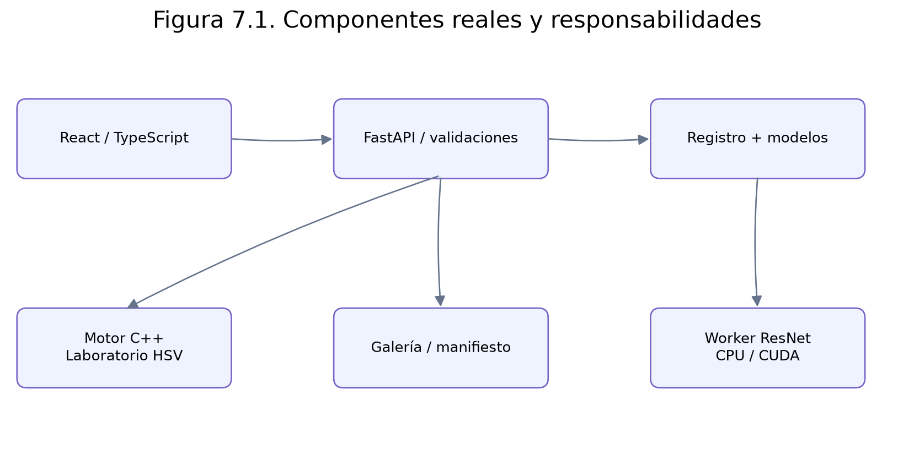

# 07. Arquitectura y recorrido del código

[TOC]

## 7.1. Componentes y responsabilidades



React y TypeScript administran archivos, selección de descriptor/modelo y visualización. FastAPI valida peticiones y coordina recursos. Los clasificadores se cargan de bundles persistidos. Un proceso separado ejecuta la CNN en su propio entorno, al primer uso. El motor C++ conserva exclusivamente el laboratorio métrico HSV144.

La aplicación es local. No necesita PostgreSQL, Supabase, servicios de IA, claves API ni una cuenta de nube para clasificar después de descargar recursos. El importador PostgreSQL y `docs/schema.sql` son complementarios y no forman parte del inicio normal.

## 7.2. Mapa del repositorio

| Ruta | Función |
| --- | --- |
| `frontend/src/App.tsx` | Navegación, selector, clasificación y alcance experimental. |
| `frontend/src/components.tsx` | Carga, vector, galerías y modal reutilizados. |
| `frontend/src/ClassifierExplorer.tsx` | Árboles, rutas, nodos e importancias. |
| `frontend/src/ClassifierEvaluation.tsx` | Métricas, matrices y exportación. |
| `backend/main.py` | Endpoints, validaciones y coordinación. |
| `backend/core.py` | Descriptor HSV y puente ctypes del motor. |
| `backend/modeling.py` | Modelos e inspección de explicaciones. |
| `backend/descriptors.py` | Registro ResNet, hashes, cachés y worker. |
| `backend/resnet_worker.py` | Extracción congelada con torch independiente. |
| `metriclab/` | Motor C++, pruebas, CLI y extractor original. |
| `experiments/` | Protocolos, diagnósticos y reportes históricos. |
| `scripts/` | Instalación, recursos, verificación, inicio y entrenamiento opcional. |
| `resources/` | Catálogos, hashes de imágenes y resúmenes pequeños. |
| `runtime/` | Artefactos instalados y datos locales; excluido de Git. |

## 7.3. Registro de descriptores

HSV se identifica como `hsv128-edge16-v1`; ResNet como `torchvision-resnet18-imagenet1k-v1-avgpool512-fp32`. El registro ResNet conserva dimensión, lista ordenada de clases, fingerprint, SHA del checkpoint y SHA de cada modelo. Cada algoritmo referencia un archivo y resultados de su ejecución de origen.

```json
{
  "descriptor": "torchvision-resnet18-imagenet1k-v1-avgpool512-fp32",
  "dimensions": 512,
  "models": {
    "lightgbm": {
      "path": "runtime/experiments/lightgbm_resnet/20261118T211652Z-600d0ec2/model.joblib"
    }
  }
}
```

El extracto omite hashes y otros campos por espacio; el registro instalado los conserva. HSV mantiene `runtime/data/active_classifiers.json`. No se elige un bundle solo por llamarse `lightgbm`: primero se determina el descriptor y luego el modelo compatible.

## 7.4. Solicitud de clasificación

El navegador envía `POST /api/classify` multipart con `file`, `descriptor_id`, `model`, `criterion` y `compare`. Se comprueban JPG/PNG, hasta 10 MB y 24 megapíxeles al decodificar. Modelo y descriptor deben ser conocidos. Un recurso ausente produce un error explícito, no una predicción inventada.

Después se extrae el vector y se valida forma y finitud. En HSV se reutilizan las funciones originales. En ResNet se pide el embedding al worker. En comparación se conserva el mismo vector para los cuatro algoritmos. Antes de inferir se comprueba la dimensión del modelo:

```python
model, classes = trained_model(key, descriptor_id)
if model.n_features_in_ != len(vector):
    raise HTTPException(409, 'El modelo no es compatible con el vector seleccionado.')
probabilities = model.predict_proba(vector[None])[0]
winner = int(model.classes_[int(np.argmax(probabilities))])
```

Fragmento reducido de `backend/main.py`. La respuesta incluye nombres de clase, probabilidades, categoría, ejemplos, descriptor, metadatos de extracción, ejecución, hash del vector y tiempos. Las rutas de explicación reciben el mismo descriptor.

## 7.5. Worker y caché

FastAPI no importa torch para arrancar HSV. `ResNetRegistry` comprueba intérprete, torch/torchvision, registro y hashes. Cuando se solicita ResNet inicia `python -u -m backend.resnet_worker` en el entorno experimental. Intercambian líneas JSON: imagen en base64 y salida como lista de 512 float32.

El worker conserva una red en evaluación. Verifica CUDA mediante una operación real y permite fallback CPU en modo automático. `METRICLAB_RESNET_DEVICE=cpu` fuerza CPU. No se descargan pesos al clasificar: deben estar instalados y validados.

La caché retiene como máximo un clasificador ResNet y cuatro vectores. La clave del vector contiene el descriptor versionado y el SHA de imagen. El bundle HSV previo sigue cargado. Un cerrojo coordina worker y cachés. Limitar referencias no garantiza liberar toda memoria reservada por el asignador ni demuestra capacidad multiusuario.

Una medición puntual dio aproximadamente 495 MiB RSS del backend y 1.107 MiB del worker principal, unos 1.613 MiB con auxiliares. No mide máximos, VRAM ni concurrencia. El consumo en otro entorno puede variar.

## 7.6. Endpoints principales

| Método y ruta | Propósito |
| --- | --- |
| `GET /api/status` | Estado de dataset, modelos y laboratorio por descriptor. |
| `GET /api/descriptors` | Opciones y motivos de indisponibilidad. |
| `GET /api/dataset` | Categorías, conteos y metadatos. |
| `POST /api/classify` | Predicción individual o comparación. |
| `GET /api/categories/{category}/images` | Hasta seis ejemplos train exactos. |
| `GET /api/images/{split}/{id}` | Imagen conocida por el manifiesto. |
| `GET /api/models/{key}/info` | Dimensión, etapas/árboles y metadatos. |
| `GET /api/models/{key}/tree` | Topología de árbol compatible. |
| `POST /api/models/{key}/path` | Ruta de la imagen por el árbol. |
| `GET /api/models/{key}/importance` | Importancia de variables. |
| `GET /api/experiments` | Prueba histórica o validación interna. |
| `POST /api/search`, `POST /api/compare` | Búsqueda métrica HSV. |
| `GET /api/tree` | Topología del índice métrico. |

Las rutas de modelos aceptan `descriptor_id`; en `path` es un campo del formulario. `experiments` admite `evaluation=historical_test` o `training_cv`. La documentación local `/docs` refleja argumentos y validaciones del código.

## 7.7. Galerías y rutas

La galería selecciona filas de `manifest['train']` cuya categoría coincide exactamente con la predicha. Los IDs se convierten en URLs conocidas. No acepta rutas arbitrarias del navegador ni busca fotos en Internet.

Las tarjetas reutilizan el componente existente, omitiendo rango y distancia cuando son ejemplos de categoría. Al cambiar modelo, criterio, descriptor o fila comparada se invalida o cambia su galería. El modal permite ampliar una imagen. Las pruebas comparan categoría, split, URL y bytes con el archivo del manifiesto.

## 7.8. Motor C++ complementario

`Engine` carga `runtime/metriclab.dll` mediante ctypes, declara tipos de la ABI C y permite crear índices, buscar, leer estructura y liberar memoria. `ml_create` recibe HSV144; no se le envía ResNet512. Otro cerrojo protege llamadas al motor compartido.

VP-Tree particiona por distancias a pivotes y utiliza desigualdad triangular para podar. LAESA usa distancias a pivotes para calcular cotas inferiores y descartar candidatos. La búsqueda secuencial es la referencia de exactitud. «Exacta» significa concordancia de vecinos según la métrica y el descriptor; no reconocimiento semántico perfecto.

Si la DLL falta, los clasificadores principales pueden seguir funcionando. Compilarla habilita laboratorio y oráculo; no cambia los modelos ni mejora accuracy automáticamente.

## 7.9. Errores y reversión

Los endpoints distinguen entrada inválida (422), recurso incompatible/indisponible (409) y dataset o índice no preparado (503 según la ruta). El frontend muestra el error. Un fallo tardío del worker puede deshabilitar ResNet; HSV sigue siendo alternativa.

`METRICLAB_ENABLE_RESNET=0` desactiva la integración al reiniciar. `METRICLAB_RESNET_PYTHON` y `METRICLAB_DESCRIPTOR_REGISTRY` permiten rutas alternativas. `.env.example` no se carga automáticamente: en PowerShell se usa `$env:NOMBRE='valor'`. Los defaults se resuelven desde la raíz del checkout, sin rutas del equipo del autor.

**Actividad:** sigue una petición desde `App.tsx` hasta `predict_proba` y localiza los controles de formato, tamaño, descriptor, dimensiones, clases y categoría de galería. Explica qué error previene cada uno.

## Evidencia

Este capítulo describe la aplicación existente, no propone reconstruirla. La distribución añade instaladores y documentación; no modifica algoritmos ni reentrena. Los informes anteriores se conservan como evidencia de sus etapas.
