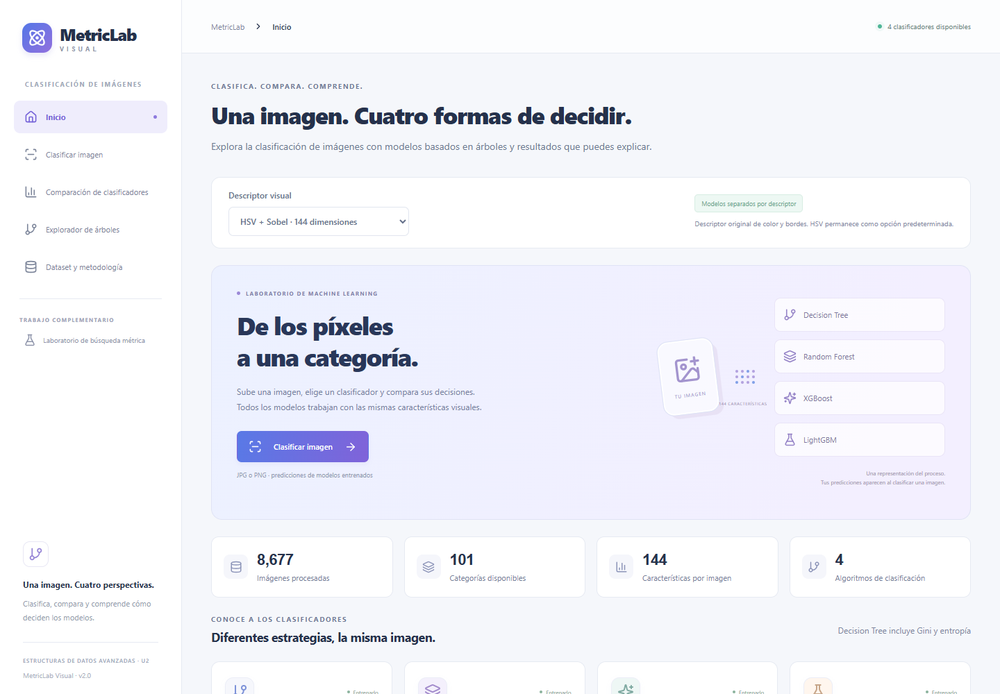
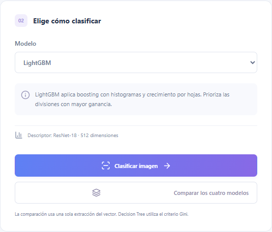
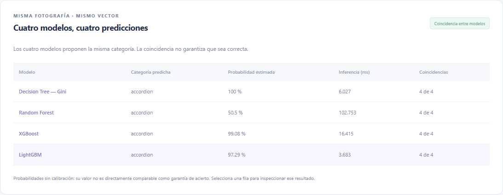
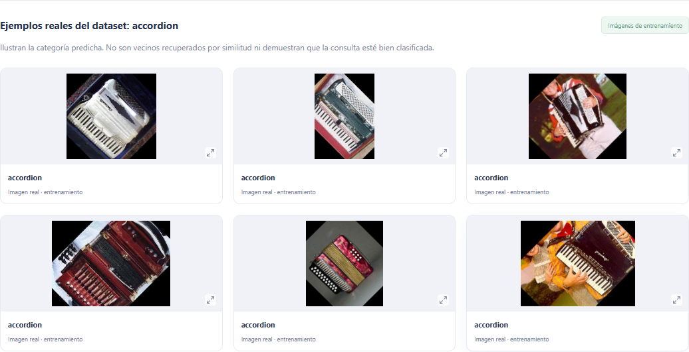
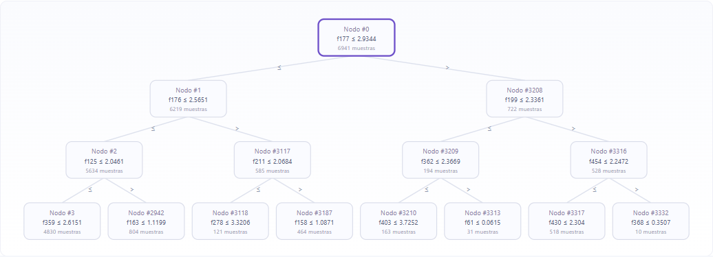
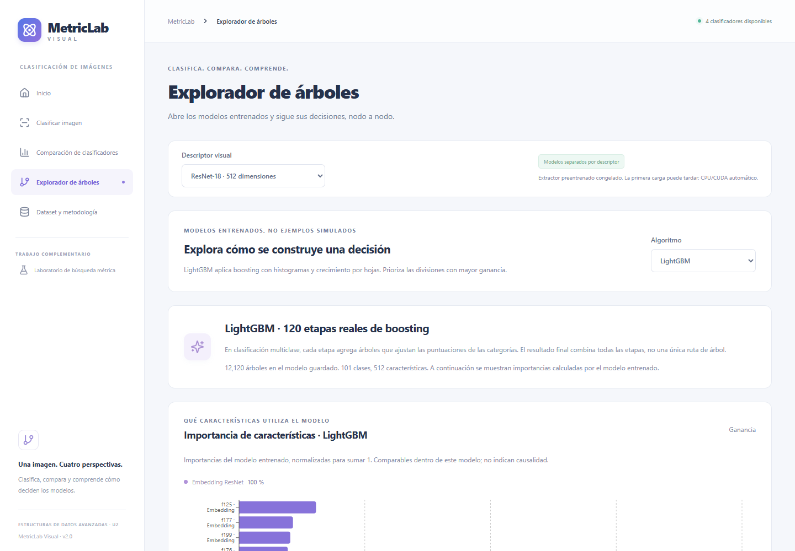
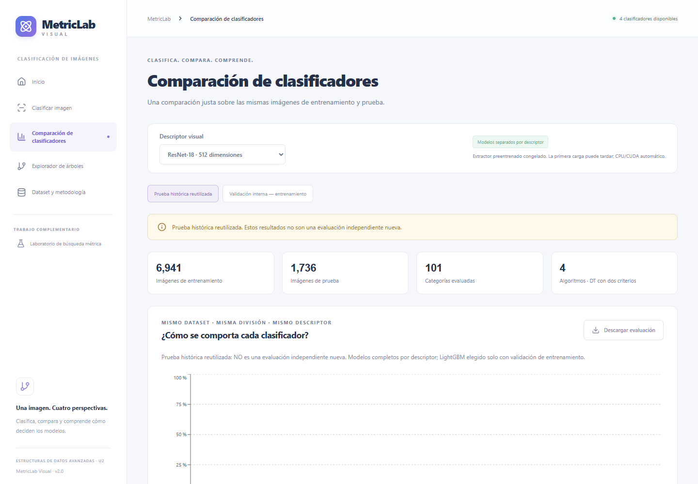
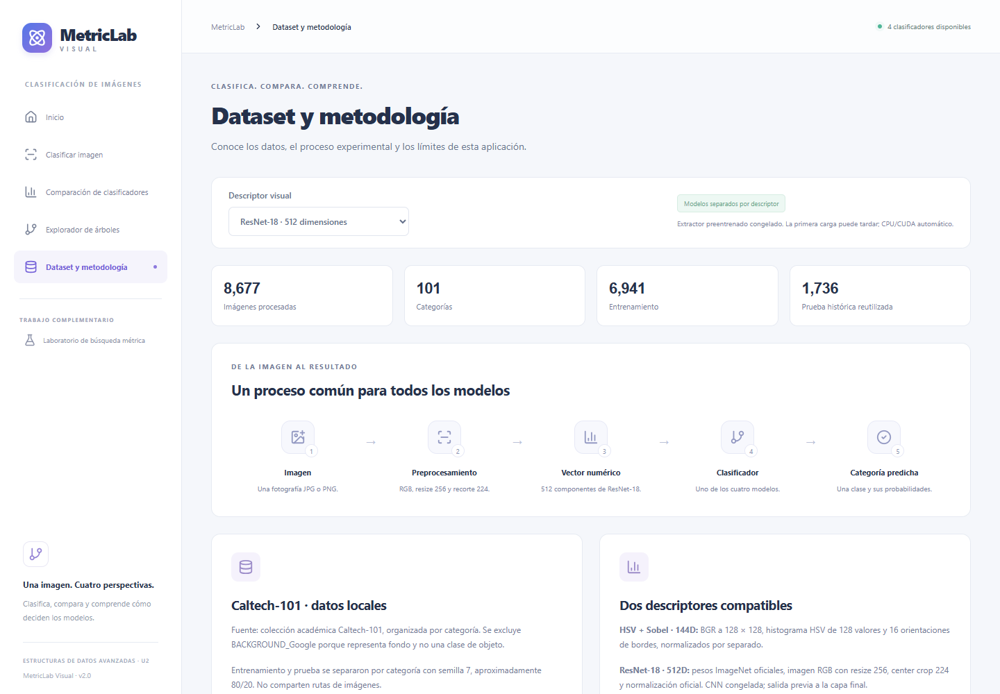

# 08. Manual de usuario con pantallas reales

Las figuras son capturas de la aplicación local. No son mockups. Las miniaturas pertenecen a Caltech-101 (Li et al., 2022; CC BY 4.0); se muestran dentro de una interfaz propia y se han redimensionado para el manual. La herramienta de captura es `scripts/capture_manual.mjs`.

[TOC]

## 8.1. Abrir Inicio

Ejecuta `.\scripts\start.ps1` y abre `http://127.0.0.1:8000`. La barra superior indica si están disponibles los clasificadores. Inicio presenta cuatro tarjetas: Decision Tree, Random Forest, XGBoost y LightGBM. Gini y entropía no aparecen como dos algoritmos distintos.

Si ves «Modelos pendientes», revisa la instalación de recursos antes de interpretar números. La aplicación no genera predicciones de demostración para sustituir modelos faltantes. La navegación lateral permite volver a cualquier módulo sin reconstruir el proyecto.

## 8.2. Cargar una fotografía

Pulsa «Clasificar imagen». Puedes seleccionar un JPG/PNG o arrastrarlo al recuadro. La interfaz muestra nombre, tamaño y vista previa. El límite es 10 MB y el backend valida además el formato real y hasta 24 megapíxeles. Renombrar un archivo de texto como `.jpg` no lo convierte en imagen válida.

Las miniaturas de prueba disponibles permiten una demostración con una fotografía conocida del dataset. No se utilizan como ejemplos de entrenamiento de la galería: son archivos del split query. Si cargas una fotografía propia no conoces su etiqueta real dentro del sistema, salvo que la hayas anotado externamente.

## 8.3. Elegir HSV o ResNet

El selector «Descriptor visual» está antes de los controles de clasificación. HSV + Sobel usa 144 dimensiones y es la opción predeterminada. ResNet-18 usa 512. Si ResNet está deshabilitado, comprueba intérprete, bibliotecas, registro y checkpoint con `verify_installation.ps1`.

Cambiar descriptor conserva la fotografía cargada, pero borra resultados anteriores. Hay que ejecutar una clasificación compatible con el nuevo descriptor. No interpretes un vector HSV como si sus barras fueran activaciones de la CNN. En ResNet, la primera consulta puede tardar varios segundos mientras se carga la red; el estado «Clasificando…» sigue activo durante esa operación.

## 8.4. Seleccionar algoritmo y criterio

Para Decision Tree, elige Gini o Entropía y pulsa «Clasificar imagen». Son criterios de construcción del árbol, no filtros visuales de la fotografía. Random Forest combina 200 árboles. XGBoost y LightGBM utilizan boosting. Todos reciben exclusivamente modelos entrenados para el descriptor elegido.

Si ya había un resultado, cambiar modelo o criterio recalcula la predicción y actualiza sus ejemplos. Durante una solicitud, los controles dependientes quedan deshabilitados para evitar mezclar resultados. No se realiza entrenamiento al cambiar una opción.

## 8.5. Leer la predicción y probabilidades

La tarjeta principal muestra categoría, nombre del clasificador y tiempo de inferencia. Las barras ordenan probabilidades estimadas; el desplegable permite ver las 101 categorías. Los valores suman aproximadamente 1 por modelo, pero no están calibrados.

Una foto ajena a las clases puede recibir igualmente una etiqueta con probabilidad alta. Un 100 % de una hoja pura describe el modelo aprendido, no una certificación de verdad. Para decidir si acertó necesitas una etiqueta real externa. Los ejemplos de la galería tampoco proporcionan esa etiqueta para la consulta.

El bloque de tiempos distingue extracción del descriptor y total de solicitud. La indicación CPU/CUDA informa dónde se ejecutó la CNN. «Vector en caché» significa que se reutilizó una extracción idéntica; no implica que el clasificador haya aprendido la imagen.

## 8.6. Comparar los cuatro modelos

Pulsa «Comparar los cuatro modelos». La tabla usa una sola extracción y muestra una fila por algoritmo. Decision Tree utiliza el criterio seleccionado. Una diferencia entre etiquetas aparece como desacuerdo; no se marca automáticamente un modelo como equivocado sin conocer la verdad.

Selecciona el nombre de una fila o su pestaña para ver sus probabilidades y ejemplos. La categoría de la galería corresponde a esa fila, aunque otras predigan otra cosa. El acuerdo «3 de 4» es una cuenta de predicciones coincidentes, no una probabilidad de acierto del 75 %.

## 8.7. Galería de seis ejemplos reales

La galería se titula «Ejemplos reales del dataset: categoría» y muestra seis fotos conocidas de esa etiqueta, sin distancia ni rango. No están ordenadas por similitud con tu fotografía. Puedes ampliarlas y cerrar el modal con Escape o el botón de cierre.

Si cambias el modelo y cambia la etiqueta, cambian también las seis fotografías. Si dos modelos coinciden, pueden mostrar los mismos ejemplos: se seleccionan por categoría, no por algoritmo. La etiqueta «Imagen real · entrenamiento» distingue esos ejemplos de consultas de prueba y de vecinos del laboratorio métrico.

## 8.8. Explorar árboles y rutas

Abre «Explorador de árboles». Selecciona Decision Tree y el criterio. Inspecciona un nodo para ver condición, muestras, impureza y clases. Las ramas representan comparaciones numéricas del vector seleccionado. En ResNet se nombran componentes del embedding, sin atribuirles partes de objeto inventadas.

«Ver ruta de imagen cargada» sigue sus decisiones hasta una hoja. El control de pasos permite recorrer la secuencia. No todas las imágenes siguen la misma rama. En Random Forest se puede elegir uno de los primeros diez árboles; el resultado final del bosque utiliza 200, no solo el árbol visible.

## 8.9. Importancia en boosting

XGBoost y LightGBM son conjuntos de árboles. La vista explica etapas e importancias; no debe confundirse con mostrar un único árbol que resuma todo el modelo. Abre el listado de 144 o 512 características según el descriptor. Las importancias están normalizadas dentro del modelo y no demuestran causalidad.

Una característica importante puede participar en muchos cortes útiles sin tener un significado semántico legible. Cambiar de descriptor reinicia rutas y explicaciones previas para mantener coherencia.

## 8.10. Comparar métricas y matriz

En «Comparación de clasificadores» elige descriptor y revisa el alcance. «Prueba histórica reutilizada» corresponde a las mismas 1.736 imágenes ya utilizadas. «Validación interna — entrenamiento» presenta CV original y confirmación posterior de LightGBM con explicaciones distintas. No hay una CV HSV guardada; no se rellenan resultados inexistentes.

Selecciona un modelo evaluado y filtra categorías para leer la matriz. Las filas son clases reales y las columnas predicciones. El filtro no cambia las métricas completas. Puedes descargar el JSON para revisar cifras y procedencia. Compara accuracy, balanced accuracy y F1 macro: una mejora en una no implica ganar en todas.

## 8.11. Dataset y laboratorio

El módulo muestra tamaños de partición, clases y distribución. Utilízalo para explicar el desbalance y la separación. El «Laboratorio de búsqueda métrica — Trabajo complementario» mantiene HSV144, índices C++ y distancias L2. Allí sí se recuperan vecinos por similitud del descriptor; su galería tiene un significado diferente de los ejemplos de categoría.

## 8.12. Problemas frecuentes

Si no hay conexión, comprueba que el servidor esté en ejecución y el puerto correcto. Si el puerto 8000 está ocupado, detén la instancia anterior o inicia con `-Port 8002`. Si ResNet no aparece disponible, ejecuta el verificador y confirma pesos y entorno. Para GPU incompatible, fuerza CPU y reinicia. Si una imagen es corrupta, prueba un JPG válido; si una miniatura no carga, verifica las imágenes del dataset.

Una predicción aparentemente incorrecta no implica un fallo de interfaz: consulta sus probabilidades, descriptor y modelo, y recuerda las limitaciones de 101 categorías. Para informar un error técnico conviene anotar pasos, mensaje, descriptor/modelo y una imagen que se pueda compartir, sin incluir credenciales ni datos personales innecesarios.
