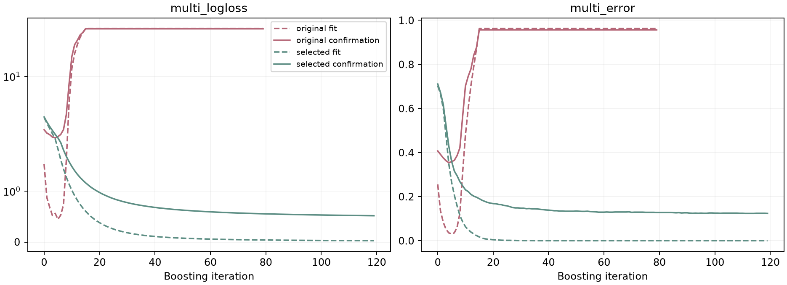

# 10. Evolución, experimentos y conclusiones

[TOC]

## 10.1. Primera implementación

El proyecto comenzó con un laboratorio C++ de búsqueda métrica y una demostración sintética. VP-Tree y LAESA se comparaban con búsqueda secuencial, y un reporte HTML mostraba ese escenario. Después se incorporó una aplicación React/FastAPI y se preparó Caltech-101 con HSV + Sobel. El reporte `MetricLab_reporte_demo.html` sigue siendo una demostración sintética: sus 400 imágenes indexadas, 100 consultas y ocho categorías no se mezclan con las cifras Caltech.

La versión actual pone clasificación como actividad principal y conserva el laboratorio como módulo complementario. Esa reorganización no convierte las estructuras métricas en árboles supervisados ni reemplaza los algoritmos C++ por respuestas simuladas.

## 10.2. Línea base HSV

La preparación original produjo 6.941 vectores de entrenamiento y 1.736 de prueba, de 144 dimensiones. Se ajustaron árboles, bosque y boosting. La referencia activa alcanzó 48,79 % de accuracy con XGBoost; RF obtuvo 46,49 %. Balanced accuracy y F1 macro fueron bastante menores: las clases pequeñas seguían siendo difíciles.

El registro HSV activo está en `runtime/data/runs/20261118T134358Z-421958bc`. Se conservan sus modelos, archivos nativos y metadatos. La investigación posterior no sobrescribió esos artefactos.

## 10.3. ResNet como experimento independiente

El run `20261118T195917Z-42d3213e` extrajo 512 activaciones con ResNet-18 oficial congelada, sin cambiar la separación ni afinar la CNN. Primero se evaluaron RF y XGB, manteniendo parámetros y controlando hilos. Se guardaron etiquetas, filas, hashes y comprobaciones CPU/GPU.

RF ResNet alcanzó 86,12 % y XGB 87,15 %. La réplica HSV de dos hilos dio 48,33 % para XGB. Una auditoría con sus cuatro hilos históricos reprodujo 48,79 % y cero predicciones distintas respecto del original. Estos resultados se registraron por separado, en vez de elegir silenciosamente la cifra más conveniente.

La mejora apoyó continuar con la representación preentrenada. No probó que cualquier modelo con 512 entradas fuera compatible ni que el resultado se mantendría en fotografías externas de distribución diferente.

## 10.4. Comparación de los cuatro algoritmos

El run `20261118T204643Z-8efb68c2` reutilizó los embeddings y los modelos completos RF/XGB. Añadió Decision Tree Gini/entropía y LightGBM. La CV estratificada de cinco folds, solo entrenamiento, compartió particiones y utilizó estimadores nuevos por fold.

XGB obtuvo F1 macro CV 0,8170 ± 0,0137 y RF 0,7743 ± 0,0105. La regla congelada recomendó XGB según validación interna. Los árboles individuales fueron menos precisos. LightGBM dio 0,1700 ± 0,0434 y 19,76 % de accuracy histórico, una señal clara para investigar.

## 10.5. Diagnóstico y regularización de LightGBM

Se verificó que el fallo no proviniera de usar HSV en un modelo ResNet ni de intercambiar etiquetas. La forma 6941×512, clases 0–100 y orden de filas eran correctos. Las curvas originales mostraron aprendizaje inicial seguido de deterioro, márgenes enormes y probabilidades saturadas.

La búsqueda posterior, run `20261118T211652Z-600d0ec2`, mantuvo 1.389 filas de entrenamiento como confirmación reservada y evaluó siete configuraciones mediante tres folds en 5.552 filas de desarrollo. La selección se basó en F1 macro y se guardó antes de abrir confirmación o volver a medir prueba.

El seleccionado incrementó el mínimo Hessiano de 0,001 a 1,0, L1 de 0 a 0,1, L2 de 0 a 5 y etapas de 80 a 120. Mantuvo 15 hojas y profundidad 6. Confirmación pasó de 4,32 % y F1 0,0302 a 87,62 % y 0,8224. El máximo margen cayó de 81.799,80 a aproximadamente 9,01 y se predijeron las 101 clases en lugar de 30.

El modelo final ajustado con las 6.941 filas obtuvo 87,33 % y F1 0,8160 en el test histórico. Los cambios fueron conjuntos: no se atribuye la solución a un único parámetro sin una ablación que lo demuestre. Tampoco se afirma que las advertencias de falta de ganancia expliquen solas el fallo, pues también aparecieron tras mejorar.

## 10.6. Integración reversible

La aplicación incorporó un selector de descriptores, un registro con hashes y modelos separados, worker ResNet bajo demanda y galerías de seis ejemplos reales de la etiqueta predicha. Se conservaron frontend, diseño, motor métrico y modelos anteriores. HSV es predeterminado y puede desactivarse ResNet por configuración.

Las comparaciones explican cuál es su descriptor y si corresponden a prueba histórica o validación interna. Los modelos no se entrenan durante una consulta. La galería ilustra categorías; no inventa distancias ni se presenta como recuperación métrica.

## 10.7. Distribución de esta entrega

Se prepararon paquetes independientes models y research, con inventario y SHA256. El primero restaura recursos de inferencia y evaluación; el segundo añade matrices, modelos históricos y trazabilidad experimental. El dataset y pesos oficiales se obtienen por separado. No se publica el entorno del autor como si fuera una instalación portable.

El repositorio conserva el historial anterior. Los diez manuales editables y sus PDF permiten estudiar tanto el uso como los cálculos. La publicación y la prueba limpia tienen informes específicos para distinguir lo ya verificado de lo pendiente. No se reentrenó ningún clasificador para preparar esta entrega.

## 10.8. Qué puede concluirse

La representación ResNet congelada mejoró ampliamente las métricas descriptivas frente a HSV con RF y XGB. Los conjuntos de árboles aprovecharon mejor esos vectores que los árboles individuales con sus configuraciones conservadas. LightGBM necesitaba estabilizar el ajuste; su bajo resultado inicial no demostraba ausencia de información en ResNet.

XGB, RF y LightGBM ajustado son opciones útiles para la aplicación. La pequeña diferencia de accuracy histórica entre XGB y LightGBM no determina un ganador universal: F1 macro ordena de otra forma y no se realizaron pruebas de superioridad. La explicación debe incluir desbalance, límites del corpus y costos reales de extracción.

## 10.9. Límites actuales

La prueba histórica fue reutilizada y el descriptor ya había sido explorado con ella. La validación interna no elimina ese antecedente. Falta un conjunto externo confirmatorio. Las probabilidades no están calibradas, no existe rechazo de categorías desconocidas y algunas clases tienen pocos casos. No se auditó solapamiento con ImageNet.

La búsqueda de siete combinaciones fue controlada, pero no exhaustiva. Sus folds y los de la comparación anterior tienen distintos tamaños. Los tiempos dependen del equipo y no incluyen todos los costos en una sola métrica. No se comprobó capacidad de producción multiusuario ni consumo máximo sostenido. Una instalación en un segundo directorio no equivale a probar otro equipo físico.

## 10.10. Mejoras futuras justificadas

Primero conviene reunir un conjunto externo con condiciones variadas y definir un protocolo antes de verlo. Después se pueden estudiar calibración y rechazo de desconocidos usando únicamente particiones apropiadas de entrenamiento/validación. Si se amplía la búsqueda, conviene presupuestarla, registrar todos los candidatos y reservar confirmación independiente.

Una ablación del mínimo Hessiano y regularización ayudaría a aislar el mecanismo del fallo LightGBM. Un benchmark separado de carga fría/caliente, CPU/GPU y concurrencia permitiría evaluar uso real. Afinar la CNN requeriría otro experimento, nueva prevención de fuga y más costos; no es una consecuencia obligatoria de la mejora observada.

**Preguntas de defensa:** ¿por qué 512 dimensiones no bastan para garantizar compatibilidad? ¿Por qué el test histórico no es nuevo? ¿Qué evidencia contradijo que LightGBM simplemente no pudiera aprender? ¿Qué parte del sistema usa GPU? ¿Por qué una galería correcta no demuestra una predicción correcta?

## Evidencias

Los informes y códigos de `experiments/resnet18`, `resnet18_comparison` y `lightgbm_resnet` conservan cada etapa. `resources/experiment_summary.json` ofrece un resumen pequeño; el paquete research contiene los artefactos completos necesarios para auditar las cifras.
