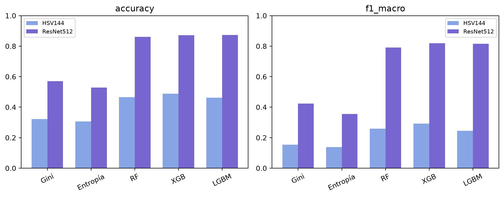

<div class="academic-cover">

# MetricLab Visual: clasificación de imágenes mediante descriptores visuales y conjuntos de árboles

**[Nombres y apellidos de los autores]**

[Institución verificada]

[Facultad o escuela]

Estructuras de Datos Avanzadas

[Nombre del docente]

19 de noviembre de 2026

</div>

## Resumen

Se presenta MetricLab Visual, una aplicación local que compara Decision Tree, Random Forest, XGBoost y LightGBM en 101 categorías de Caltech-101. Se conservan 6.941 imágenes de entrenamiento y 1.736 de prueba histórica. La representación original concatena histogramas HSV y Sobel en 144 dimensiones; la alternativa utiliza 512 activaciones de ResNet-18 preentrenada y congelada. Los resultados descriptivos muestran mejoras amplias con el nuevo descriptor para bosque y XGBoost. Un diagnóstico posterior de LightGBM identificó márgenes excesivos y probabilidades saturadas, y una búsqueda controlada exclusivamente dentro de entrenamiento seleccionó una configuración regularizada. Esta alcanzó 87,62 % de accuracy en confirmación interna reservada y 87,33 % en la prueba histórica reutilizada. Se integraron ambos descriptores sin sustituir modelos anteriores, con galerías reales por categoría y trazabilidad. La entrega incluye instaladores y paquetes verificados para ejecutar modelos sin reentrenar. Se reconoce que la prueba histórica no constituye validación independiente nueva y que faltan evaluación externa y calibración.

*Palabras clave:* clasificación de imágenes, ResNet-18, árboles de decisión, boosting, reproducibilidad.

## Índice

[TOC]

## Introducción

### Contexto y problema

Una computadora recibe una fotografía como una matriz de números. El nombre del archivo no explica qué aparece en ella. MetricLab Visual estudia cómo transformar esa matriz en una representación útil para predecir una categoría: acordeón, avión, hormiga y otras 98 clases de objetos de Caltech-101. La finalidad es académica: observar el proceso, comparar alternativas y explicar límites, además de obtener una etiqueta.

La aplicación permite cargar una imagen JPG o PNG, seleccionar una representación visual y elegir un clasificador. Presenta la categoría más probable, probabilidades estimadas, tiempos y ejemplos reales del entrenamiento. También permite comparar los cuatro algoritmos sobre el mismo vector. Si discrepan, muestra el desacuerdo; no conoce la respuesta correcta de una fotografía arbitraria del usuario.

El sistema reconoce únicamente sus 101 categorías. Ante una fotografía de un objeto ajeno a ellas seguirá asignando una de esas clases: no se implementó un detector de categoría desconocida. Por tanto, que una probabilidad sea alta no demuestra que el objeto pertenezca al dataset ni que la predicción sea correcta.

## Problema, justificación y objetivos

El problema consiste en predecir una de 101 categorías a partir de fotografías con resoluciones y apariencias variables, manteniendo una evaluación interpretable. Una representación global simple puede perder organización espacial; una representación aprendida puede conservar patrones útiles, pero añade dependencias y costos. Comparar clasificadores sin controlar descriptor, separación y versiones produciría conclusiones poco trazables.

El objetivo general es desarrollar y estudiar una aplicación de clasificación que permita comparar métodos con datos reales. Los objetivos específicos son preservar separación e integridad; contrastar dos descriptores y cuatro familias; investigar el fallo de LightGBM sin ajustar sobre prueba; integrar resultados de forma reversible; y facilitar su estudio y ejecución por otro estudiante. El laboratorio métrico permite relacionar estas actividades con pivotes, distancias y poda, sin confundir índices de búsqueda con clasificadores supervisados.

## Marco teórico

ResNet fue propuesta por He et al. (2016) como una arquitectura de aprendizaje residual. Random Forest combina árboles aleatorizados (Breiman, 2001). XGBoost implementa boosting regularizado y optimizaciones para construir conjuntos de árboles (Chen & Guestrin, 2016). LightGBM desarrolla un sistema eficiente basado en árboles y técnicas de entrenamiento (Ke et al., 2017). El proyecto utiliza estas bibliotecas y mantiene sus parámetros reales; no implementa desde cero esos cuatro estimadores.

### Representaciones aprendidas

Una red convolucional aplica filtros compartidos a distintas posiciones de una imagen. Las activaciones de capas sucesivas combinan respuestas locales. A diferencia de fijar de antemano bins de color, sus filtros se aprenden al optimizar una tarea con ejemplos. En MetricLab esos filtros ya estaban entrenados en ImageNet; solo se usan para representar imágenes.

ResNet incorpora conexiones residuales: un bloque calcula una transformación F(x) y suma una conexión de x, con proyección cuando cambian las dimensiones. La formulación es y=F(x)+x cuando las formas coinciden (He et al., 2016). Eso facilita optimizar redes profundas. No significa que el modelo pueda explicar verbalmente cada objeto ni que un componente aislado sea «un ojo» o «una rueda».

ResNet-18 tiene una convolución inicial, grupos de bloques básicos [2,2,2,2] con 64,128,256 y 512 canales, pooling global y una capa final de clasificación en su diseño original. El nombre 18 cuenta capas con parámetros según la arquitectura publicada; no equivale a contar todos los módulos Python.


### Preentrenamiento y congelación

Los pesos `ResNet18_Weights.IMAGENET1K_V1` fueron aprendidos para clasificar 1.000 categorías de ImageNet. El proyecto los carga mediante torchvision, reemplaza `fc` por `Identity`, desactiva gradientes y usa modo evaluación. No se reaprenden convoluciones ni se adaptan estadísticas BatchNorm con Caltech-101.

```python
weights = ResNet18_Weights.IMAGENET1K_V1
network = resnet18(weights=weights, progress=True)
network.fc = torch.nn.Identity()
network.requires_grad_(False)
network.eval()
preprocessing = weights.transforms()
```

La extracción se realiza dentro de `torch.inference_mode()`. Congelar parámetros y poner evaluación son controles distintos: el primero impide actualizarlos por gradiente; el segundo configura capas con comportamiento diferente en entrenamiento y evaluación. El experimento comparó el hash del estado antes y después de extraer para verificar que tampoco cambió BatchNorm.

### Preprocesamiento reproducible

La imagen se convierte a RGB. Se redimensiona el lado corto a 256 y se toma un recorte central de 224 × 224. Este procedimiento conserva proporciones antes del recorte; no consiste en deformar directamente a 224 × 224. Los canales pasan a valores entre 0 y 1 y se normalizan con medias [0,485; 0,456; 0,406] y desviaciones [0,229; 0,224; 0,225].

Por ejemplo, un canal rojo de valor 128 produce (128/255−0,485)/0,229≈0,074. Un valor normalizado puede ser negativo o superar 1: eso es esperado. Se usa directamente `weights.transforms()` para mantener la misma interpolación y transformación oficial, sin sustituirla por una aproximación manual. Las instrucciones están en la [documentación de ResNet-18](https://docs.pytorch.org/vision/stable/models/generated/torchvision.models.resnet18.html).

### Pooling y embedding

Con la entrada de 224 × 224, la última representación convolucional contiene 512 mapas de 7 × 7. Average pooling calcula la media espacial de cada mapa. Si un mapa de ejemplo tuviera valores [1,3;5,7], su media sería 4. En la red real cada media resume 49 posiciones:


Se obtienen 512 valores, se aplana la dimensión espacial y `fc=Identity` deja pasar esas activaciones. No se utilizan las 1.000 probabilidades originales de ImageNet como vector. Tampoco se aplica una normalización L2 adicional al embedding del proyecto.

Un componente es la respuesta agregada de un canal aprendido en interacción con los demás. Puede correlacionarse con patrones, pero no tiene una etiqueta semántica garantizada. En el explorador se denomina «componente del embedding N» para evitar atribuirle una explicación que no fue comprobada.

### Árboles de decisión e impureza

Un árbol de decisión formula preguntas del tipo «¿x[j] ≤ umbral?». Cada respuesta lleva a un hijo. La construcción comienza con todas las filas de entrenamiento en la raíz y busca una variable y un umbral que separen mejor las clases. Después repite el proceso en los hijos hasta alcanzar sus restricciones o no encontrar una mejora.

Las hojas guardan distribuciones de clases de sus ejemplos. Si una hoja contiene 8 acordeones y 2 cámaras, su distribución básica es [0,8;0,2] en esas dos categorías. Eso no representa la probabilidad de acierto externo de 80 %: solo resume la distribución aprendida y no está calibrada con fotografías externas.

En un embedding, una pregunta puede ser «componente 237 ≤ 0,58». El componente tiene significado numérico dentro del extractor congelado, pero no se puede traducir automáticamente como «tiene teclado». El explorador muestra el número de muestras, umbral, impureza, clases y condición tomada por la fotografía cargada.

#### Gini y entropía


Gini vale cero cuando todos los registros pertenecen a la misma clase. La entropía también es cero para un nodo puro, con la convención 0·log(0)=0. En una mezcla de dos clases al 50 %, Gini=1−0,5²−0,5²=0,5 y entropía=−2·0,5·log₂(0,5)=1 bit. No se comparan directamente 0,5 y 1 como si compartieran escala: son criterios distintos.

Ejemplo resuelto: un nodo padre contiene 6 imágenes A y 4 B. Sus proporciones son 0,6 y 0,4, por lo que Gini=1−0,36−0,16=0,48. Su entropía es −0,6·log₂(0,6)−0,4·log₂(0,4)≈0,9710 bits.

Un corte candidato produce un hijo izquierdo con 4 A y 0 B y un derecho con 2 A y 4 B. Gini izquierdo=0. Gini derecho=1−(2/6)²−(4/6)²=4/9≈0,4444. La impureza ponderada queda (4/10)·0+(6/10)·0,4444≈0,2667; la reducción es 0,48−0,2667≈**0,2133**.


Con entropía, el hijo derecho tiene H≈0,9183 y la entropía ponderada es 0,6·0,9183≈0,5510. La ganancia es 0,9710−0,5510≈**0,4200 bits**. Ambos criterios pueden favorecer ese corte, pero no tienen por qué ordenar igual todos los cortes de un dataset real.

#### Selección y limitaciones

Se evalúan cortes sobre variables candidatas y se selecciona la reducción de impureza permitida por el estimador. La decisión es local: elegir el mejor corte actual no garantiza el árbol globalmente óptimo. Un árbol profundo puede memorizar irregularidades. Cambios pequeños en datos o empates pueden producir otra estructura.

Los modelos ResNet originales usan `criterion='gini'` o `'entropy'`, `max_depth=None`, `min_samples_split=2`, `min_samples_leaf=1`, `ccp_alpha=0` y `random_state=0`. Se conserva la configuración completa en el resumen de parámetros y protocolos. No se podaron nuevamente para esta entrega. Sus accuracies históricos son 57,09 % y 52,88 %; son inferiores a los conjuntos de árboles.

### Bosques y agregación

Un bosque busca reducir la variabilidad de un árbol individual. En bootstrap se toman filas con reemplazo: algunas pueden repetirse y otras quedar fuera de un árbol. Además, en cada corte solo se considera una selección de características. Estas dos fuentes de aleatoriedad favorecen que los errores de los árboles no sean idénticos.

En el bosque de MetricLab hay **200 árboles**, con `bootstrap=True`, `max_features='sqrt'`, `random_state=0` y `n_jobs=2` en el modelo ResNet. Para 512 entradas, la raíz cuadrada es aproximadamente 22,6; el estimador selecciona un número entero de características según su implementación. No significa que se reduzca permanentemente el vector a 22 columnas: la selección cambia entre nodos.

La API de sklearn promedia probabilidades de los árboles. Si tres árboles hipotéticos producen para A [0,7;0,4;0,8], el promedio de A es (0,7+0,4+0,8)/3≈0,6333. Si B recibe el resto, A gana. No debe explicarse necesariamente como una votación de etiquetas duras: promediar distribuciones puede dar otro resultado que contar únicamente las clases máximas de cada árbol.

El bosque suele ser más estable que un árbol, pero ocupa más memoria y requiere recorrer muchos árboles por consulta. Las importancias por reducción de impureza muestran cuánto contribuyeron variables a cortes durante el ajuste; no prueban causalidad y pueden favorecer variables con muchas oportunidades de corte. La página permite explorar los primeros diez árboles, no afirma que esos diez sean todo el bosque de 200.

## Metodología

### Dataset y atribución

Caltech-101 fue recopilado en 2003 para investigar reconocimiento de categorías con pocos ejemplos. El registro oficial describe aproximadamente 40–800 imágenes por categoría y fotografías de alrededor de 300 × 200 píxeles. Los creadores del registro son Fei-Fei Li, Marco Andreeto, Marc'Aurelio Ranzato y Pietro Perona (Li et al., 2022). El nombre de autor «Andreeto» se conserva como figura en los metadatos del DOI, aunque existen variantes ortográficas en otras fuentes.

La fuente verificable es [CaltechDATA, DOI 10.22002/D1.20086](https://doi.org/10.22002/D1.20086). Los metadatos de DataCite declaran **Creative Commons Attribution 4.0 International**. La atribución y el enlace de licencia se mantienen en `docs/LICENCIAS_Y_RECURSOS.md`. No se incluye una copia completa en Git: el instalador obtiene el ZIP de la fuente oficial y verifica su checksum publicado.

Las fotografías de ejemplo y las miniaturas visibles en las capturas de este manual proceden de Caltech-101. Se han redimensionado o integrado en composiciones para explicar la aplicación; no fueron generadas por IA ni obtenidas de buscadores. La licencia del dataset no equivale a una garantía sobre todos los posibles derechos de imagen o marcas representadas.

### Separación fija y verificación

Se conserva exactamente la división original: **6.941 entrenamiento y 1.736 prueba histórica**. No se ejecuta una nueva separación para instalar ni para cambiar de descriptor. El script original ordena carpetas y archivos, baraja mediante un generador compartido con semilla 7 y reserva, en cada categoría, aproximadamente el 20 % para consulta. Usa `round(n * .2)` y asegura que quede al menos una imagen por partición.

Esta es una división estratificada por categoría implementada en el script; no corresponde a llamar posteriormente a `train_test_split` con una semilla que solo parezca equivalente. Por ejemplo, para una clase de 55 imágenes se reservan 11 y se entrenan 44; para una de 800 se reservan 160 y se entrenan 640. La suma de redondeos por clase determina los totales finales.

El fingerprint guardado es:

```text
1dad6c2f85e8d806ba351218a934b5955e8bc7afc25b063f8f95751efaa2455f
```

Se calcula a partir de vectores HSV y filas del manifiesto. Para comprobar además el contenido de las fotografías, `resources/image_manifest.json` conserva SHA-256 de las 8.677 imágenes, su categoría, split e ID. Una carpeta con los mismos nombres pero fotos diferentes no pasa esta comprobación.

### Validación interna original

En cinco folds, el entrenamiento se divide en cinco partes estratificadas. Se ajusta un modelo con cuatro y se predice la restante; luego cambia la parte reservada. Al finalizar, cada imagen tiene una predicción out-of-fold de un modelo que no la utilizó para aprender. El resultado se resume por media y desviación muestral entre folds.

Ejemplo pequeño: 100 ejemplos repartidos en cinco partes de 20. En cada ajuste se usan 80 y se evalúan 20. Los cinco conjuntos de ajuste se solapan, por lo que sus resultados no son cinco experimentos totalmente independientes. La desviación expresa dispersión observada, no un intervalo de confianza automático.

En la comparación ResNet original se usó `StratifiedKFold(n_splits=5, shuffle=True, random_state=23)`. Las cinco configuraciones —dos criterios y tres conjuntos de árboles— compartieron índices. Se mantuvieron parámetros fijos y no se utilizó early stopping. XGBoost obtuvo el mayor F1 macro medio, 0,8170 ± 0,0137; el LightGBM original, 0,1700 ± 0,0434.

### Búsqueda controlada y confirmación

La investigación posterior separó entrenamiento en **5.552 desarrollo y 1.389 confirmación**, estratificando con semilla 41. Dentro de desarrollo se crearon tres folds con semilla 29. Se definieron siete configuraciones antes de medirlas. La regla de selección fue mayor F1 macro medio y, en empate, balanced accuracy.

La selección se guardó en `selection.json` antes de evaluar confirmación. La configuración 2 logró F1 medio 0,785848 y DE 0,005886. Después se ajustaron original y seleccionado con los 5.552 registros de desarrollo y se compararon una sola vez sobre los 1.389 reservados. Esos resultados confirmaron una mejora; no se volvieron a usar para buscar otra configuración.

Finalmente se ajustó el seleccionado con los 6.941 registros completos y se volvió a medir la prueba histórica. Los tiempos de búsqueda y los ajustes internos no son el tiempo de ajuste final de 48,617 s. Mezclarlos produciría una comparación de costos engañosa.

### Prevención de fuga y alcance de evaluación

La separación no debe usarse únicamente al final del script. Se mantiene durante selección de parámetros, transformaciones que aprendan de datos, calibración y decisiones de versión. En este proyecto el extractor ResNet está fijo: calcular previamente todas sus activaciones no usa las etiquetas ni ajusta estadísticas con Caltech. Si se afinara la red o se aprendiera un normalizador con todos los splits, el razonamiento cambiaría y habría que situar ese ajuste dentro de cada entrenamiento correspondiente.

Los chequeos de integridad sí leen vectores, rutas y etiquetas de prueba para verificar correspondencia; no calculan con ellos un criterio de selección. Una comprobación de checksum no equivale a entrenar. Sin embargo, observar repetidamente accuracy de prueba para decidir el enfoque general sí introduce un antecedente de exploración que debe reconocerse.

No se usaron las 1.736 imágenes para elegir los parámetros nuevos de LightGBM. Eso no convierte la prueba completa en inédita: había sido consultada durante etapas anteriores. La CV es interna y condicional al descriptor previamente elegido. Una evaluación externa futura debe planificarse antes de observar sus resultados.

## Implementación

### Recorrido de una solicitud

El navegador envía `POST /api/classify` multipart con `file`, `descriptor_id`, `model`, `criterion` y `compare`. Se comprueban JPG/PNG, hasta 10 MB y 24 megapíxeles al decodificar. Modelo y descriptor deben ser conocidos. Un recurso ausente produce un error explícito, no una predicción inventada.

Después se extrae el vector y se valida forma y finitud. En HSV se reutilizan las funciones originales. En ResNet se pide el embedding al worker. En comparación se conserva el mismo vector para los cuatro algoritmos. Antes de inferir se comprueba la dimensión del modelo:

```python
model, classes = trained_model(key, descriptor_id)
if model.n_features_in_ != len(vector):
    raise HTTPException(409, 'El modelo no es compatible con el vector seleccionado.')
probabilities = model.predict_proba(vector[None])[0]
winner = int(model.classes_[int(np.argmax(probabilities))])
```

Fragmento reducido de `backend/main.py`. La respuesta incluye nombres de clase, probabilidades, categoría, ejemplos, descriptor, metadatos de extracción, ejecución, hash del vector y tiempos. Las rutas de explicación reciben el mismo descriptor.

### Worker y recursos persistentes

FastAPI no importa torch para arrancar HSV. `ResNetRegistry` comprueba intérprete, torch/torchvision, registro y hashes. Cuando se solicita ResNet inicia `python -u -m backend.resnet_worker` en el entorno experimental. Intercambian líneas JSON: imagen en base64 y salida como lista de 512 float32.

El worker conserva una red en evaluación. Verifica CUDA mediante una operación real y permite fallback CPU en modo automático. `METRICLAB_RESNET_DEVICE=cpu` fuerza CPU. No se descargan pesos al clasificar: deben estar instalados y validados.

La caché retiene como máximo un clasificador ResNet y cuatro vectores. La clave del vector contiene el descriptor versionado y el SHA de imagen. El bundle HSV previo sigue cargado. Un cerrojo coordina worker y cachés. Limitar referencias no garantiza liberar toda memoria reservada por el asignador ni demuestra capacidad multiusuario.

Una medición puntual dio aproximadamente 495 MiB RSS del backend y 1.107 MiB del worker principal, unos 1.613 MiB con auxiliares. No mide máximos, VRAM ni concurrencia. El consumo en otro entorno puede variar.

### Integración de ejemplos reales

Cada predicción se asocia con seis fotografías de entrenamiento cuya categoría exacta se obtiene del manifiesto. No se calculan distancias para elegirlas ni se presentan como validación del acierto. Los modelos se seleccionan por descriptor, con controles de clases, dimensión, fingerprint y hashes. El laboratorio C++ permanece limitado a HSV144 y mantiene su oráculo de búsqueda.

## Resultados

**Tabla 1**

*Resultados históricos HSV + Sobel (144 dimensiones)*

| Modelo | Accuracy | Balanced acc. | F1 macro | Ajuste (s) | Inferencia (ms) |
| --- | ---: | ---: | ---: | ---: | ---: |
| DT Gini | 32,26 % | 15,90 % | 0,1541 | 1,024 | 0,054 |
| DT entropía | 30,59 % | 13,77 % | 0,1376 | 2,813 | 0,053 |
| Random Forest | 46,49 % | 24,77 % | 0,2585 | 1,160 | 22,949 |
| XGBoost | 48,79 % | 28,21 % | 0,2914 | 10,692 | 1,382 |
| LightGBM | 46,20 % | 23,69 % | 0,2450 | 5,999 | 0,812 |

*Nota.* N=1.736 imágenes de prueba histórica reutilizada. Los tiempos de entrenamiento de árboles y bosque se conservaron de ajustes anteriores. Inferencia excluye extracción y HTTP. Fuente: artefactos versionados de MetricLab Visual (2026).

**Tabla 2**

*Resultados descriptivos ResNet-18 integrados (512 dimensiones)*

| Modelo | Accuracy | Balanced acc. | F1 macro | Ajuste (s) | Inferencia (ms) |
| --- | ---: | ---: | ---: | ---: | ---: |
| DT Gini | 57,09 % | 42,46 % | 0,4237 | 15,273 | 0,075 |
| DT entropía | 52,88 % | 35,78 % | 0,3553 | 59,565 | 0,057 |
| Random Forest | 86,12 % | 77,41 % | 0,7903 | 36,733 | 22,700 |
| XGBoost | 87,15 % | 80,55 % | 0,8184 | 42,869 | 3,107 |
| LightGBM regularizado | 87,33 % | 80,91 % | 0,8160 | 48,617 | 0,687 |

*Nota.* Misma prueba histórica; no es evaluación independiente nueva. RF/XGB completos se conservaron. Los tiempos de las ejecuciones respectivas no son un benchmark simultáneo. Las diferencias pequeñas no establecen superioridad estadística.

**Figura 1**

*Accuracy y F1 macro por descriptor y clasificador*



*Nota.* Elaboración propia desde los artefactos conservados. La tabla separa sus alcances; no se ajustaron los modelos para esta entrega.

### Diagnóstico y mejora de LightGBM

Se verificó que el fallo no proviniera de usar HSV en un modelo ResNet ni de intercambiar etiquetas. La forma 6941×512, clases 0–100 y orden de filas eran correctos. Las curvas originales mostraron aprendizaje inicial seguido de deterioro, márgenes enormes y probabilidades saturadas.


La búsqueda posterior, run `20261118T211652Z-600d0ec2`, mantuvo 1.389 filas de entrenamiento como confirmación reservada y evaluó siete configuraciones mediante tres folds en 5.552 filas de desarrollo. La selección se basó en F1 macro y se guardó antes de abrir confirmación o volver a medir prueba.

El seleccionado incrementó el mínimo Hessiano de 0,001 a 1,0, L1 de 0 a 0,1, L2 de 0 a 5 y etapas de 80 a 120. Mantuvo 15 hojas y profundidad 6. Confirmación pasó de 4,32 % y F1 0,0302 a 87,62 % y 0,8224. El máximo margen cayó de 81.799,80 a aproximadamente 9,01 y se predijeron las 101 clases en lugar de 30.

El modelo final ajustado con las 6.941 filas obtuvo 87,33 % y F1 0,8160 en el test histórico. Los cambios fueron conjuntos: no se atribuye la solución a un único parámetro sin una ablación que lo demuestre. Tampoco se afirma que las advertencias de falta de ganancia expliquen solas el fallo, pues también aparecieron tras mejorar.

## Discusión

### Interpretación de los hallazgos

La representación ResNet congelada mejoró ampliamente las métricas descriptivas frente a HSV con RF y XGB. Los conjuntos de árboles aprovecharon mejor esos vectores que los árboles individuales con sus configuraciones conservadas. LightGBM necesitaba estabilizar el ajuste; su bajo resultado inicial no demostraba ausencia de información en ResNet.

XGB, RF y LightGBM ajustado son opciones útiles para la aplicación. La pequeña diferencia de accuracy histórica entre XGB y LightGBM no determina un ganador universal: F1 macro ordena de otra forma y no se realizaron pruebas de superioridad. La explicación debe incluir desbalance, límites del corpus y costos reales de extracción.

### Limitaciones

La prueba histórica fue reutilizada y el descriptor ya había sido explorado con ella. La validación interna no elimina ese antecedente. Falta un conjunto externo confirmatorio. Las probabilidades no están calibradas, no existe rechazo de categorías desconocidas y algunas clases tienen pocos casos. No se auditó solapamiento con ImageNet.

La búsqueda de siete combinaciones fue controlada, pero no exhaustiva. Sus folds y los de la comparación anterior tienen distintos tamaños. Los tiempos dependen del equipo y no incluyen todos los costos en una sola métrica. No se comprobó capacidad de producción multiusuario ni consumo máximo sostenido. Una instalación en un segundo directorio no equivale a probar otro equipo físico.

## Conclusiones

La comparación apoya mantener ResNet-18 como descriptor alternativo: conserva modelos anteriores y mejora las métricas descriptivas de conjuntos de árboles respecto de HSV. La representación no garantiza por sí sola un buen ajuste: LightGBM necesitó investigación y regularización. Su mejora se confirmó dentro de entrenamiento antes de volver a medir prueba.

La aplicación permite estudiar decisiones, importancias, matrices y ejemplos reales sin equiparar probabilidades con certeza ni galerías con recuperación métrica. La persistencia y los paquetes con hashes permiten ejecutar sin volver a entrenar. Las conclusiones de generalización siguen limitadas por reutilizar la prueba histórica y por la ausencia de una evaluación externa prospectiva.

### Trabajo futuro

Primero conviene reunir un conjunto externo con condiciones variadas y definir un protocolo antes de verlo. Después se pueden estudiar calibración y rechazo de desconocidos usando únicamente particiones apropiadas de entrenamiento/validación. Si se amplía la búsqueda, conviene presupuestarla, registrar todos los candidatos y reservar confirmación independiente.

Una ablación del mínimo Hessiano y regularización ayudaría a aislar el mecanismo del fallo LightGBM. Un benchmark separado de carga fría/caliente, CPU/GPU y concurrencia permitiría evaluar uso real. Afinar la CNN requeriría otro experimento, nueva prevención de fuga y más costos; no es una consecuencia obligatoria de la mejora observada.

**Preguntas de defensa:** ¿por qué 512 dimensiones no bastan para garantizar compatibilidad? ¿Por qué el test histórico no es nuevo? ¿Qué evidencia contradijo que LightGBM simplemente no pudiera aprender? ¿Qué parte del sistema usa GPU? ¿Por qué una galería correcta no demuestra una predicción correcta?

## Referencias

Breiman, L. (2001). Random forests. *Machine Learning, 45*, 5–32. https://doi.org/10.1023/A:1010933404324

Chen, T., & Guestrin, C. (2016). XGBoost: A scalable tree boosting system. En *Proceedings of the 22nd ACM SIGKDD International Conference on Knowledge Discovery and Data Mining* (pp. 785–794). ACM. https://doi.org/10.1145/2939672.2939785

He, K., Zhang, X., Ren, S., & Sun, J. (2016). Deep residual learning for image recognition. En *Proceedings of the IEEE Conference on Computer Vision and Pattern Recognition* (pp. 770–778). https://doi.org/10.1109/CVPR.2016.90

Ke, G., Meng, Q., Finley, T., Wang, T., Chen, W., Ma, W., Ye, Q., & Liu, T.-Y. (2017). LightGBM: A highly efficient gradient boosting decision tree. En *Advances in Neural Information Processing Systems, 30*. https://proceedings.neurips.cc/paper/2017/hash/6449f44a102fde848669bdd9eb6b76fa-Abstract.html

Li, F.-F., Andreeto, M., Ranzato, M., & Perona, P. (2022). *Caltech 101* (Version 1.0) [Data set]. CaltechDATA. https://doi.org/10.22002/D1.20086

Li, F.-F., Fergus, R., & Perona, P. (2006). One-shot learning of object categories. *IEEE Transactions on Pattern Analysis and Machine Intelligence, 28*(4), 594–611. https://doi.org/10.1109/TPAMI.2006.79

Los autores de MetricLab Visual. (2026). *Protocolos, predicciones y resultados versionados de MetricLab Visual* [Artefactos experimentales]. Ejecuciones `20261118T134358Z-421958bc`, `20261118T195917Z-42d3213e`, `20261118T204643Z-8efb68c2` y `20261118T211652Z-600d0ec2`. Repositorio y paquetes asociados: https://github.com/GUIDO-DBP/metriclab-visual

## Apéndice: fuentes editables y reproducibilidad

Los diez manuales complementarios desarrollan cálculos, código, pantallas e instalación. `resources/experiment_summary.json` y los paquetes versionados contienen la evidencia numérica. Los campos de portada son marcadores deliberados y deben completarse antes de presentar el trabajo; no se ha supuesto una institución a partir de documentos antiguos. El registro de prueba limpia distingue la comprobación en un segundo directorio de una prueba física en otro equipo.
