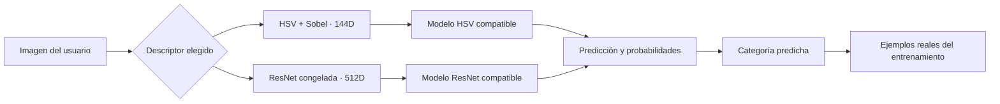

# Plan de integración: dos descriptores y fotografías reales por categoría

Este documento prepara una integración posterior. **No se modifica ni activa nada en la aplicación actual.** La elección del candidato se apoya en la validación interna del experimento de comparación, no en escoger el mayor resultado de la prueba histórica.

Conclusión de la ejecución completada: XGBoost es el candidato según F1 macro medio de CV (0,8170 ± 0,0137); Random Forest es una alternativa (0,7743 ± 0,0105). LightGBM quedó entrenado y evaluado, pero con esta configuración su CV fue 0,1700 ± 0,0434: conservarlo como resultado experimental y no proponerlo como opción recomendada hasta investigar su precisión/dispersión usando únicamente entrenamiento. No sustituir estas cifras por resultados simulados ni por las métricas HSV.

## 1. Registro explícito de descriptores y modelos compatibles

Preparar un registro separado del registro de algoritmos:

| Descriptor | Dimensiones | Preprocesamiento | Modelos asociados |
| --- | ---: | --- | --- |
| `hsv128-edge16-v1` | 144 | Extractor actual, 128 × 128, HSV + Sobel | Los modelos HSV/Sobel activos, conservados |
| `torchvision-resnet18-imagenet1k-v1-avgpool512-fp32` | 512 | PIL RGB y transforms oficiales, ResNet congelada, fc Identity | Gini, entropía y LightGBM de la extensión; RF/XGBoost del experimento padre |

Cada entrada debe registrar ID de descriptor, dimensionalidad, orden/codificación de clases, fingerprint de separación, SHA de pesos y modelos, versiones, configuración del preprocesamiento y origen de la evaluación. `model_catalog_proposal.json` es un inventario concreto de los artefactos ResNet existentes, todavía sin activar.

No cargar un modelo por nombre de algoritmo solamente: utilizar la pareja `(descriptor_id, model_key)`. Verificar `n_features_in_`, vector finito y fingerprint antes de inferir. Gini y entropía siguen agrupados bajo Decision Tree.

Los bundles históricos RF/XGBoost del experimento padre guardan el alias corto `resnet18`; los nuevos usan el ID completo. Preparar un adaptador de lectura para ese formato histórico, autorizado por el SHA del modelo y el catálogo del experimento padre, sin reescribir el bundle. Compartir 512 dimensiones por sí solo no prueba compatibilidad con cualquier otro embedding.

No hace falta mover ni sobrescribir los bundles anteriores para ensayar la integración. El registro puede referenciarlos en lectura y mantener la referencia HSV predeterminada. Una activación futura deberá ser explícita y reversible mediante una referencia versionada.

## 2. Backend: extracción e inferencia sin reentrenamiento

Adaptar `backend/core.py`, `backend/modeling.py` y `backend/main.py` cuando se autorice la integración:

- Un contrato de extractor con `id`, `dimensions`, `describe(image)` y metadatos. Conservar la implementación HSV y añadir ResNet mediante importación diferida de PyTorch.
- Cargar ResNet una vez al utilizarla, en `eval()` y `inference_mode()`, sin gradientes ni entrenamiento. Verificar CUDA con una operación real; permitir CPU. Si ResNet no está disponible, deshabilitar solo ese descriptor y conservar HSV operativo.
- Evitar cargar todos los bosques/boosters de ambos descriptores a la vez. Usar caché limitada de modelos y extractor, medir consumo y liberar modelos inactivos. No depender de CUDA para arrancar la página.
- Añadir `descriptor_id` a `/api/classify`. La comparación extrae **una sola vez** el vector del descriptor elegido y ejecuta los cuatro algoritmos compatibles.
- Distinguir tiempos de preprocesamiento/extracción, inferencia del clasificador y total de solicitud. Las mediciones actuales de `predict_proba` no incluyen la CNN.
- Devolver `descriptor_id`, dimensión, `model_run_id`, pesos/preprocesamiento y origen de evaluación para impedir mezclar métricas HSV y ResNet.
- Si se utiliza caché de consultas, su clave debe incluir hash de imagen **y** ID/versionado del descriptor; nunca reutilizar un vector de 144D en un modelo 512D.

Contratos propuestos:

```text
GET  /api/descriptors
     descriptores, dimensiones, estado, modelos disponibles y motivo de indisponibilidad

POST /api/classify
     file, descriptor_id, model, criterion, compare
     predicciones, probabilidades, extracción_ms, inferencia_ms, descriptor_id, model_run_id

GET  /api/experiments?descriptor_id=...&evaluation=training_cv|historical_test
     resultados de la ejecución concreta; contexto y advertencias visibles

GET  /api/models/{key}/tree?descriptor_id=...&tree_index=...
     árbol del modelo compatible; aplicar el mismo descriptor_id a info/importancia/path

GET  /api/categories/{category_id}/images?split=train&limit=6
     IDs de imágenes reales y URLs existentes /api/images/train/{id}
```

El laboratorio C++ complementario conserva inicialmente el descriptor HSV de 144D: el puente actual valida esa dimensión. No enviarle embeddings de 512D como efecto secundario de este cambio de clasificación. Ampliarlo requeriría otra tarea y sus propias pruebas.

## 3. Galería de imágenes reales de la categoría predicha

Construir un índice de metadatos **del entrenamiento** `category -> image_ids`. No descargar fotos de buscadores ni generar imágenes. `gallery_examples_proposal.json` contiene una propuesta revisable derivada de rutas/etiquetas reales del manifiesto, hasta seis ejemplos por clase.

Al recibir una predicción, buscar imágenes cuya categoría original coincida exactamente con la etiqueta predicha. Devolver solo IDs conocidos; el endpoint existente de imágenes resuelve la ruta relativa validada. Usar `category_id` canónico en vez de aceptar rutas de archivos del navegador.

Comportamiento propuesto de la tarjeta de resultado:

1. Mostrar la fotografía del usuario, la categoría predicha, el clasificador y el descriptor.
2. Mostrar probabilidades y sus límites: no son confianza calibrada ni garantía de acierto.
3. Mostrar una galería con el título **«Ejemplos reales del dataset: categoría predicha»** y la etiqueta **«Imágenes de entrenamiento»**.
4. Ampliar una imagen con el modal ya existente. Si no está el archivo, mostrar un estado de imagen ausente y conservar la predicción.
5. En comparación de cuatro, cada fila puede abrir los ejemplos de **su propia categoría**. Si los modelos discrepan, no elegir silenciosamente una como verdadera.

Estos ejemplos ilustran la etiqueta; **no son vecinos recuperados por similitud y no demuestran que la consulta esté bien clasificada**. Evitar textos como «coincidencia exacta» o distancias inexistentes. No incorporar fotografías de prueba al entrenamiento, a la selección de ejemplos ni al ajuste de modelos.

## 4. Frontend: selector comprensible y navegación actual conservada

En `frontend/src/App.tsx`, añadir antes del selector de modelo:

- **Color y bordes — HSV + Sobel (144D)**: descriptor original, rápido y sin CNN.
- **Patrones visuales — ResNet-18 (512D)**: extractor preentrenado, requiere sus pesos y librerías; CPU/CUDA según estado real.

Conservar la imagen cargada al cambiar de descriptor, pero invalidar vector, resultados y rutas anteriores para que no queden datos de la selección previa. Deshabilitar modelos sin artefacto compatible, con explicación corta. No rellenar predicciones durante una descarga o carga de pesos.

Reutilizar `UploadCard`, `Gallery`, `ImageModal` y las tablas existentes. Para la nueva galería de categorías, separar el componente de la galería métrica: debe omitir rango/distancia y mostrar categoría/origen. Actualizar tipos para incluir `descriptor_id` y metadatos sin mezclar el vector con el objeto de descriptor.

En comparación experimental, selector de descriptor y dos bloques inequívocos:

- **Validación interna — solo entrenamiento:** cinco folds, media ± desviación y predicciones OOF; no etiquetarla como evaluación externa.
- **Prueba histórica reutilizada:** las mismas 1.736 imágenes ya evaluadas. Incluir fecha, run y advertencia; nunca llamarla «nueva validación».

En `ClassifierExplorer`, adaptar los nombres de características. HSV/bordes conserva sus nombres actuales; los componentes 0–511 de ResNet se denominan **«componente del embedding N»**, sin inventar que un canal representa un ojo, un borde o una parte del objeto. Rutas e importancias deben pertenecer al modelo y descriptor seleccionados.



## 5. Criterios de aceptación y despliegue posterior

1. El sistema existente y sus catorce pruebas de integración siguen pasando; la selección original produce las mismas predicciones que hoy.
2. Para cada descriptor, los cuatro algoritmos predicen con sus propios artefactos y la misma codificación de clases; ambas opciones de Decision Tree funcionan.
3. Dos descriptores sobre una imagen generan vectores de dimensiones correctas y sus propios resultados. La comparación de cuatro extrae solo una vez por descriptor.
4. Las imágenes de galería existen en disco, pertenecen a la categoría mostrada y a entrenamiento, y se sirven por IDs validados. Ningún porcentaje, foto o distancia se simula.
5. Se prueban navegación, arrastre, ampliación, estados de error, móvil y descarga de métricas. Cambiar descriptor invalida las vistas anteriores.
6. Se verifica funcionamiento sin CUDA y sin PyTorch/weights: HSV sigue operativo y ResNet informa su estado.
7. Se conserva un inventario versionado y una reversión inmediata a HSV, sin borrar modelos ni experimentos. Medir memoria y latencia completa con modelos precargados.

Orden sugerido para una futura implementación autorizada: registro/validaciones → API de descriptor y caché → galería real por categoría → selector frontend → explorador/métricas por descriptor → pruebas CPU/GPU y revisión visual → activación reversible.

La validación interna permite proponer un candidato, pero no convierte la prueba histórica en una evaluación nueva. Antes de afirmar generalización definitiva, reservar un conjunto externo no utilizado en la exploración previa o fijar un protocolo prospectivo independiente.
